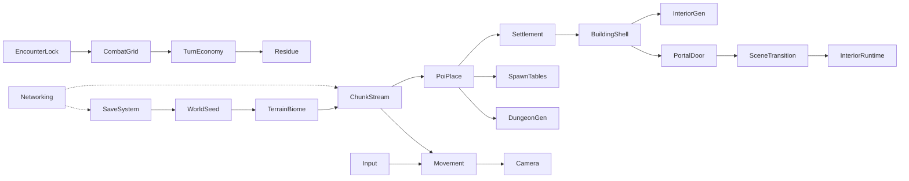

# 17 Game Systems Architecture

Version: 1.48

Status: Draft

Last Updated: 2026-11-13 (P.3: code state after S5b.5, drinking a Limit potion and its Assimilation. Earlier: P.3: code state after S5b.4, alchemy at the three benches. Earlier: P.4: code state after S5b.2 and S5b.3, growth by every use, the Character Page and Perception's secondary share in the hit chance. Earlier: P.4: code state after S5b.1, the creation page, the bodies and the identity in the save. Earlier: X.3: code state after S5c.1, the exact Suspend Save built: its parts, the slot, the restart of the city, the people and the refusals; X.6: "Save and quit" and the start's offer. Earlier: X.3: the Suspend Save keeps the world's exact state, every person where it is and doing what it does, and is refused also during a Reaction Check, a work under way, sleep and Assimilation, by the owner's answer to S5-7. Earlier: C.1: the combat rework, 10.2 §5f: what changes in `Confront/Rules/`, `CharacterSkill`, the Shot Line and the ability service, built by the slice's milestones CR1–CR6. Earlier: X.6: Esc closes any window and opens the menu, the reaction bar below the prompt, the HUD's size on the owner's tuning page (PB7). Earlier: C.1: the grid at 30 cells measured in PB5a, a step 1.26 ms at the median. Earlier: C.1: the grid reaches 30 cells, by the owner's direction after the play test of 2026-11-12; its cost measured again in PB5.
 Earlier: X.6: the HUD's Screen Messages, an outcome or a hint on the screen for 2.5 s, never in a prompt (owner). Earlier: 2026-11-09: C.1 and C.5: code state after S3a.4, the Encounter Lock and the turns on the Combat Grid; C.2 gains `TryCellAt`. Earlier: C.2: code state after S3a.3, the Combat Grid behind `ICombatGrid` in `GameDev.Confront.Grid`. Earlier: C.5: code state after S3a.2, the headless fight. Earlier: C.5: code state after S3a.1, the fight's numbers as one service, `FightRules`. Earlier: A.3: code state after S2.7, the next day's residue, a sealed door and a lie found out. Earlier: A.3: code state after S2.6, an option that prepares and a lost Final Check. Earlier: A.3: code state after S2.5, a Decision Node as data and a POI's scene in the world. Earlier: Q.2: the News Pool, by the owner, not built. Earlier: A.3: code state after S2.4, the dialogue column and the first conversations; X.7: the `dialogue` table. Earlier: A.3: code state after S2.3, a conversation as data and `IDialogueRunner`. Earlier: P.3: code state after S2.2, the character's standing in conversation. Earlier: P.3: code state after S2.1, the character's values and the action and Social Checks. Earlier: X.7: code state after S2.0, the tables, their keys and the language switch. Earlier: X.7 Localization: every player-facing string by key, Russian and English, by the owner; the project's own string tables as the authoring default. Earlier: I.2, I.3 and the interior-load default: the street stays loaded behind an interior, by the owner's choice of D3 (a) in the Veilmouth reference plan; a door takes about 0.5 s, measured. Earlier: Later waves: loose props V1 built in the slice's kit. Earlier: Later waves: the owner's requests of 2026-11-06, loose props, a room constructor, street animals, city transport, and cabs, named with their open questions. Earlier: X.3 and X.6: the save contract and the first HUD, from S0.5. Earlier: I.1–I.3: the first doors, from S0.4. Earlier: L.1–L.3: the code lives in its owning folders, from S0.3. Earlier: X.1: the first `IWorldClock` contract, from S0.1. Earlier: next code default: the Vertical Slice implementation plan, in one hand-built scene, by the owner's decision. Earlier: the slice's Suspend Save, townsfolk schedules, and the Item Creation workshop, by the owner's answers. Earlier: unseen fights run the tactical rules without drawing, by the owner. Earlier: faction state holds forces and City Control; Influence is read from them. Earlier: Social Checks added to A.3 Dialogue. Earlier: stealth added to Wave C. Earlier: CC-33 gate passed; colliders added to Wave C. Earlier: Combat Grid build cost measured. Earlier: Combat Grid reach set to 20 cells in every direction. Earlier: Combat Grid card updated: around the player only. Earlier: Track C rebuilt for combat in place. Earlier: Vertical Slice scope updated for the one-city slice. Earlier: the campaign's 3×3 target world recorded next to the V0 default. Earlier: Track E gains the City Control and Force Generation card from 21. Earlier: Player-system track now includes mandatory potion-only Alchemy; detailed profession rules remain in 20.)

Depends On:
[21 Cult Campaign and City Control](21%20Cult%20Campaign%20and%20City%20Control.md), [16 Architecture Pivot](16%20Architecture%20Pivot.md), [14 World Generation Roadmap](14%20World%20Generation%20Roadmap.md), [15 Procedural Building Generation](15%20Procedural%20Building%20Generation.md), [12 Engine Choice](12%20Engine%20Choice.md), [11 Vertical Slice](11%20Vertical%20Slice.md), [10.1 Grid World and Environment Actions](10.1%20Grid%20World%20and%20Environment%20Actions.md), [10.2 Combat System Draft](10.2%20Combat%20System%20Draft.md), [18 World Time and Living Simulation](18%20World%20Time%20and%20Living%20Simulation.md), [08 Confront Constraints](08%20Confront%20Constraints.md), [02 World Laws](02%20World%20Laws.md), [03 Decision Engine](03%20Decision%20Engine.md)

Referenced By:
[AGENTS.md](AGENTS.md), [19 Items, Crafting, Inventory, Equipment, and Enchanting](19%20Items%2C%20Crafting%2C%20Inventory%2C%20Equipment%2C%20and%20Enchanting.md), [20 Alchemy and Potioncraft](20%20Alchemy%20and%20Potioncraft.md), [14 World Generation Roadmap](14%20World%20Generation%20Roadmap.md), [90 Glossary](90%20Glossary.md), [99 Open Questions](99%20Open%20Questions.md), `unity/Assets/Plans/OVERWORLD_V0_PLAN.md`, `unity/Assets/Plans/AGENT_HANDOFF_WORLD_GEN.md`, `unity/Assets/Plans/SETTLEMENT_PROPERTY_V0.md`, `unity/Assets/Plans/VEILMOUTH_REFERENCE_PLAN.md`

---

# Purpose

This document is the **systems map authority**: which systems exist, what each owns, how they communicate, and which micro-iterations implement them.

It does **not** replace spatial / presentation locks in [16 Architecture Pivot](16%20Architecture%20Pivot.md). If a systems proposal contradicts scene rules in `16`, `16` wins.

Success question for agents:

> Can a new agent open this file, find the System Card for the feature they want, see its interfaces and upstream dependencies, and pick the next micro-iteration without inventing a monolith manager?

---

# Authority Split

| Document | Authority |
|----------|-----------|
| [16 Architecture Pivot](16%20Architecture%20Pivot.md) | Scene graph, movement mode per scene, Confront in place |
| [14 World Generation Roadmap](14%20World%20Generation%20Roadmap.md) | Ordered world-gen phases / stop point |
| [15 Procedural Building Generation](15%20Procedural%20Building%20Generation.md) | Exterior Shell Grammar + Interior Piece Assembly; Building DNA |
| **This document (`17`)** | System registry, interfaces, save/MP/perf notes, iteration backlog |

---

# Architectural Laws

1. **No monolithic managers.** Prefer many independent systems composed by thin coordinators.
2. **Composition over inheritance.** No assigning external functions onto classes; no reflection tricks for gameplay wiring.
3. **SOLID + data-driven.** Immutable game data may live in ScriptableObjects. **Runtime state never lives in ScriptableObjects.**
4. **Determinism.** World structure generates from `WorldSeed` + coordinates (or stable ids). Do not roll gameplay-structure RNG at runtime if it can be derived.
5. **Chunk-based streaming.** Overworld expansion is effectively infinite at the API level; V0 uses a small playable stub.
6. **Interfaces and events.** Systems own their data. No circular dependencies. Hidden singletons that smuggle cross-domain state are forbidden.
7. **Independently testable.** Every system has EditMode (or pure C#) tests for its deterministic core.
8. **Iteration budget.** Never implement a feature larger than ~500 lines of code in one iteration. Design → break into subsystems → one component → review → refactor → continue.
9. **Multiplayer-ready core state.** Even while shipping single-player first, core world identity (seed, chunk payloads, POI ids, residue) must not assume local-only mutable globals.
10. **Design gates.** Combat trees, quest lines, faction lore, and economy simulation must instantiate [02 World Laws](02%20World%20Laws.md) and [03 Decision Engine](03%20Decision%20Engine.md) — this document records **boundaries and interfaces**, not full content mechanics, for gated tracks.
11. **Piece-Based Assembly, small → large.** World, Settlement, and Building/Interior generation compose from small hand-authored Pieces with Snap Sockets (Valheim-style room/dungeon piece model), never from a whole hand-tuned continuous mesh or an algorithmic subdivision solver. Binding for Track W and [15](15%20Procedural%20Building%20Generation.md); the retired OrganicTown continuous pipeline ([13](13%20City%20Generation.md)) is not a reuse source.

## Scene reminder (from 16)

```text
Overworld (seeded, free 3P)
  ├── door/portal → Interior Scene (free 3P, no grid) → exit back
  └── Confront → Combat Grid over the current scene (TB) → free movement + residue
Interior ── Confront ──┘
```

## Locked V0 engineering defaults

| Default | Value |
|---------|-------|
| Chunk size | **64 m** |
| Overworld V0 playable world | **2800 × 2800 m** — 2×2 Unity Terrain tiles of 1400 m (chunk API as if infinite) |
| Campaign target world | **4200 × 4200 m** — 3×3 tiles of 1400 m, with 5–7 cities ([21](21%20Cult%20Campaign%20and%20City%20Control.md)). A game-design target: it changes no V0 default and authorises no production terrain work. |
| Terrain height budget / sea level | **700 m** / **24 m** |
| Terrain resolution | heightmap **513**, alphamap **512**, details **512** per tile — written by the terrain bake from TerrainGen ([OVERWORLD_TERRAIN_ARCHITECTURE](unity/Assets/Plans/OVERWORLD_TERRAIN_ARCHITECTURE.md)) |
| Interior load | **Additive**: the street stays loaded, switched off, behind an interior (I.2; owner, 2026-11-08) |
| OrganicTown / TownGridBaker continuous path | **Deprecated** — archive only, not a reuse source ([13](13%20City%20Generation.md)) |
| Combat depth in near-term | Combat Grid V0 TB skeleton; BG3-depth is long-horizon |

---

# System Card Template

Every system below uses this card. Fields are mandatory.

| Field | Meaning |
|-------|---------|
| **Responsibilities** | What this system owns and does |
| **Dependencies** | Upstream systems only (no cycles) |
| **Public interfaces** | Types / events other systems may use |
| **Data flow** | Inputs → transforms → outputs |
| **Save/load** | What persists; what is regenerated |
| **Multiplayer** | Authority / replication notes (even if SP-first) |
| **Performance** | Hot paths, budgets, streaming concerns |
| **Extensibility** | How V2/V3 grow without rewrite |
| **V1 scope / Deferred** | Near-term include vs later |
| **Owning folder** | Intended `unity/Assets/Scripts/…` home |

---

# Third-Party Asset Library

Which imported (and pending) third-party packages serve which System Card is tracked in `unity/Assets/Plans/ASSET_LIBRARY_REFERENCE.md` — check it before reaching for a new tool or writing custom code for terrain, vegetation, locomotion animation, or UI/camera tweening.

# World Generation Pipeline (target shape for Track W)

`unity/Assets/Plans/WORLD_GENERATION_PIPELINE.md` distills the full target world-gen pipeline (world layout → macro terrain → hydrology → biomes → materials → vegetation → roads → settlements → streaming) and cross-references each stage to a System Card below. It is not a build-order override — `OVERWORLD_V0_PLAN.md` and the Micro-iteration Backlog still govern what ships next — but every future Track W wave should stay consistent with it instead of inventing terrain features ad hoc.

---

# Track Map

| Track | Systems | Near-term code |
|-------|---------|----------------|
| **W — World Gen** | WorldSeed, Terrain/Biome, Chunk Streaming, POI Placement, Settlement, Building/Shell, Interior Gen, Dungeon Gen, Spawn Tables | **Yes — Overworld V0 first** |
| **L — Locomotion** | Input, Movement, Camera, Animation (locomotion) | After Overworld V0 |
| **I — Interior Rails** | Portal/Door, Scene Transition, Interior Runtime | After Locomotion V0 |
| **C — Confront** | Encounter Lock, Combat Grid, Tactical Combat Action Economy, Residue | After Interior V0 |
| **A — Actors** | NPC Gen, AI (non-combat), Dialogue | Design cards; code later |
| **Q — Quest / Info** | Quest Gen, Information Sources, POI Director | Design cards; Decision Engine gate |
| **E — Economy / Factions** | Economy, Factions, City Control and Force Generation, Crafting | Design cards; World Laws gate |
| **P — Player** | Inventory, Equipment, Skills/Arcana, Alchemy and advancement potions, Character Life | Design cards; Progression gate; rules in [20 Alchemy and Potioncraft](20%20Alchemy%20and%20Potioncraft.md) |
| **X — Cross-cutting** | Time, Weather, Save, Networking, Audio, UI | Thin cards; Save/Net contracts early |

---

# Dependency DAG



---

# Track W — World Gen (full cards)

## W.1 WorldSeed

| Field | Content |
|-------|---------|
| **Responsibilities** | Hold world identity integer/long; fork named deterministic streams (`Fork("terrain")`, `Fork("poi")`, …); never mutate seed after world create. |
| **Dependencies** | None (root). |
| **Public interfaces** | `IWorldSeed { int Value; System.Random Fork(string streamId); }` — pure, no Unity scene ownership. |
| **Data flow** | Create-world / load → seed value → consumers fork streams by stable string ids. |
| **Save/load** | Persist seed value + schema version. Regenerable derived data is not saved unless mutated by play. |
| **Multiplayer** | Host/authority owns seed; clients receive seed once and regenerate deterministic structure locally or receive chunk payloads. |
| **Performance** | Negligible; fork cost must stay allocation-light. |
| **Extensibility** | New systems add new stream ids; never reuse stream ids with different semantics. |
| **V1 scope / Deferred** | V0: int seed + string forks. Deferred: hierarchical region seeds if needed. |
| **Owning folder** | `unity/Assets/Scripts/World/Seed/` (evolve existing `WorldSeed` toward interface). |

## W.2 Terrain / Biome

| Field | Content |
|-------|---------|
| **Responsibilities** | Sample height and biome band from seed + world XZ; expose read-only sampler; no mesh ownership. |
| **Dependencies** | WorldSeed. |
| **Public interfaces** | `IBiomeSampler { float SampleHeight(Vector2 worldXZ); BiomeId SampleBiome(Vector2 worldXZ); }` |
| **Data flow** | Seed fork `"terrain"` → noise / band rules → height + biome at query point. |
| **Save/load** | Regenerated from seed; save only if player-altered terrain is ever allowed (not V0). |
| **Multiplayer** | Same seed → same samples on all peers; no per-frame sync of heightfields. |
| **Performance** | Sampling must be O(1) / cheap noise; cache per-chunk if builders need grids. |
| **Extensibility** | Swap noise implementation behind `IBiomeSampler`; add moisture/temperature channels later. |
| **V1 scope / Deferred** | V0: TerrainGen island + massifs + **Stage 4A island floor relief** + ocean, baked into Unity Terrain (R1 is the authority field since 2026-09-18, `GeneratorVersion` 2 — [design](unity/Assets/Plans/PROCEDURAL_TERRAIN_STAGE_4_ISLAND_RELIEF_DESIGN.md)). Deferred: inland hydrology by default, full Valheim-scale biomes, Stage 3F valley carve, Stage 4B plateaus. |
| **Owning folder** | `unity/Assets/Scripts/World/Terrain/` |

## W.3 Chunk Streaming

| Field | Content |
|-------|---------|
| **Responsibilities** | Map world ↔ `ChunkCoord` (64 m); decide which chunks are resident around a focus; request build/teardown via interfaces; no biome math ownership. |
| **Dependencies** | Terrain/Biome (for builders it schedules), WorldSeed. |
| **Public interfaces** | `ChunkCoord`; `IChunkStreamer { void SetFocus(Vector3); IReadOnlyCollection<ChunkCoord> Resident; event ChunkLoaded; event ChunkUnloaded; }`; `ITerrainChunkBuilder { void Build(ChunkCoord); void Teardown(ChunkCoord); }` |
| **Data flow** | Focus position → desired set → build missing / teardown distant → resident set events. |
| **Save/load** | Chunk geometry regenerates; persist only chunk overrides / residues later. |
| **Multiplayer** | Interest management per player focus; authority may validate chunk residency; payload = seed-derived or delta overrides. |
| **Performance** | Hard budget: build/teardown amortized; never hitch on many chunks same frame — queue work. |
| **Extensibility** | Pluggable builders (terrain, props, POI visuals) register as composers; streamer stays thin. |
| **V1 scope / Deferred** | V0: `ChunkCoord` / `OverworldTileChunks` math at 64 m over the 2800 m world. Deferred: the streamer itself, async jobs, LOD, infinite travel polish. |
| **Owning folder** | `unity/Assets/Scripts/World/Streaming/` |

## W.2b Landscape Planner (roads + ocean exclusion)

| Field | Content |
|-------|---------|
| **Responsibilities** | Plan POIs / roads against shared terrain analysis, then conform road corridors; own `WorldDefinition` aggregate. Ensure ocean plane at Sea Level. |
| **Dependencies** | WorldSeed, Terrain/Biome, POI Placement, Roads; ocean sampler (`SeaLevelOceanSampler`). |
| **Public interfaces** | `WorldDefinition` / `WorldGenSettings` / `OverworldWorldState`; `LandscapePlanner`; `LandscapeCostField`; `TerrainDeformer` (roads); `RoadDefinition` + corridor/vertical profile; `IWaterSampler` / `WaterProximity`. |
| **Data flow** | Seed + settings → POI plan once → Primary/Secondary roads (no RNG) → corridor deform → ensure `WorldWater` → visuals → vegetation. |
| **Save/load** | Regenerable from seed + settings; scene holds plan for editor tools. |
| **Multiplayer** | Same seed + settings → same geography; no per-frame sync. |
| **Performance** | Cost field cell ~10 m; A* on tile grid; corridor dig once per generate. |
| **Extensibility** | Road/POI knobs via `WorldGenSettings`; Local road stubs deferred; inland hydro redesign deferred (not a restore of removed lake/river types). |
| **V1 scope / Deferred** | V0: hierarchical roads + World Generator + **ocean only**. Deferred: Local roads, inland lakes/rivers, multi-tile. |
| **Owning folder** | `unity/Assets/Scripts/World/Landscape/` + `WorldDefinition`; plan: `unity/Assets/Plans/LANDSCAPE_PLANNER.md`. |

## W.4 POI Placement

| Field | Content |
|-------|---------|
| **Responsibilities** | Deterministically place POI markers (ruin, camp, shrine, town approach, cave mouth, …) from seed + chunk/world coords; emit stable `PoiId`. |
| **Dependencies** | WorldSeed, Terrain/Biome, Landscape analysis (slope/flatness), Chunk Streaming (placement evaluated per chunk or world pass). |
| **Public interfaces** | `IPoiPlacer { IReadOnlyList<PoiMarker> PlaceForChunk(ChunkCoord); }`; `PoiMarker { PoiId Id; PoiKind Kind; Vector3 Position; BiomeId Biome; }`; `PoiPlacementProfile` (hard/soft/relation/footprint) + `PoiPlacementCatalog` + `PoiPlacementEngine`. |
| **Data flow** | Chunk candidates + seed fork `poi.{kind}.{index}` + per-kind profile scoring (TownApproach first) → stable sorted marker list written once into `WorldDefinition`. |
| **Save/load** | Marker positions regenerable; persist discovery state / Active Window / resolution elsewhere (POI Director). |
| **Multiplayer** | Same markers from seed; discovery/state is per-player or shared by design later. |
| **Performance** | Cap markers per chunk; no global scans each frame. |
| **Extensibility** | New `PoiKind` = add a `PoiPlacementProfile` to the catalog. ScriptableObject wrappers deferred; V0 uses a plain C# catalog. |
| **V1 scope / Deferred** | V0: demo quotas via `PoiDemoScenario` + profile scoring. Deferred: timed Side Event POIs density, multi-district, SO authoring. |
| **Owning folder** | `unity/Assets/Scripts/World/Poi/` |

## W.5 Settlement

| Field | Content |
|-------|---------|
| **Responsibilities** | Turn settlement-scale POIs (town approach, hamlet) into layout intents: road hints, plot footprints, district tags — **not** continuous enterable city GridMap. |
| **Dependencies** | POI Placement, WorldSeed, Terrain/Biome. |
| **Public interfaces** | `ISettlementLayout` / `ISettlementPropertyLayout` (`Plots` = building pads; `Properties` = parcels + zones + boundaries); generator from `PoiMarker` of settlement kinds (overworld hook later). |
| **Data flow** | Seed fork `"settlement_*"` → `SettlementBlockLayout` (PlotParcel + zones + boundaries + BuildingPad) → Building/Shell + feature placeholders. Overworld: Settlement POI → layout pose (deferred). |
| **Save/load** | Regenerable layout; persist only player/faction mutations later. |
| **Multiplayer** | Deterministic layout from seed; mutations replicated as deltas. |
| **Performance** | Generate on chunk/settlement demand; cache layout data. |
| **Extensibility** | Compose settlement layout from the Piece Kit (plot/road/block Pieces) per [15](15%20Procedural%20Building%20Generation.md) — not from the retired OrganicTown polygon generator. |
| **V1 scope / Deferred** | **Property lab S1–S8** (`SETTLEMENT_PROPERTY_V0.md`): parcels → Shell; S5 Street Spine; S6 TownApproach pose + terrain snap + dry search; S7 District Mix (`CreateDistrictMix`: Commercial + GardenSquare + Worker); S8 Street Props on ribbons. Stub layout remains for contract tests. Deferred: terraces / carved pads, TownDress meshes, full pathfinding StreetNetwork. |
| **Owning folder** | `unity/Assets/Scripts/World/Settlement/` |

## W.6 Building / Shell

| Field | Content |
|-------|---------|
| **Responsibilities** | Exterior shells / landmarks on overworld via **Exterior Shell Grammar**; door sockets; Building DNA stub fields; no in-overworld enterable interiors. |
| **Dependencies** | Settlement (or lone POI), WorldSeed; Exterior Piece Kit + DNA rules from [15](15%20Procedural%20Building%20Generation.md). |
| **Public interfaces** | `IBuildingShellBinder { ShellInstance Bind(BuildingDna dna, PlotFootprint plot, StreetContext street); }`; shell may expose `PortalSocket` when `InteriorPolicy.Portal`. |
| **Data flow** | DNA / archetype + plot + StreetContext → ShellInstance (pieces) + optional portal metadata → Interior Gen key. |
| **Save/load** | Shell regenerable; persist damage/ownership later. |
| **Multiplayer** | Deterministic instance ids from seed+plot; state deltas for damage. |
| **Performance** | Shared materials, Piece LOD slots, trim capped by wealth; HLOD later. |
| **Extensibility** | Modular TownDress library; grammar grows by Piece Kit, not whole-building prefabs. |
| **V1 scope / Deferred** | **Shell Sandbox lab** (`GameDev/Buildings/Shell Sandbox`, `BUILDING_SHELL_SANDBOX_V0.md`) runs **parallel to Overworld V0** and does not block W0.x. Production Settlement wiring after Overworld V0; Portal interiors after Interior V0 rails. Overworld V0 itself: POI markers only. |
| **Owning folder** | `unity/Assets/Scripts/World/Buildings/Shell/` |

## W.7 Interior Generation

| Field | Content |
|-------|---------|
| **Responsibilities** | Build or select Interior Scene content from building id + seed (one hand template → later Piece-Based Assembly / Room Graph). Free 3P space; **no grid**. |
| **Dependencies** | Building/Shell (portal key), WorldSeed; Piece Kit + Room Graph generator from [15](15%20Procedural%20Building%20Generation.md). |
| **Public interfaces** | `IInteriorSceneKey { BuildingId Id; int SeedFork; }`; `IInteriorCompiler { InteriorSceneSpec Compile(IInteriorSceneKey); }` |
| **Data flow** | Portal activate → scene key → compile/load interior → exit returns overworld pose. |
| **Save/load** | Geometry regenerable; persist interior mutables (looted containers, NPCs) by building id. |
| **Multiplayer** | Instance interiors per party or shared instance — decide at net layer; key stays deterministic. |
| **Performance** | One interior resident at V0; unload on exit. |
| **Extensibility** | Phase toward Room Graph compiler without changing portal contract. |
| **V1 scope / Deferred** | Interior V0: one hand template scene. DNA authority later (`99`). |
| **Owning folder** | `unity/Assets/Scripts/World/Interiors/` |

## W.8 Dungeon Generation

| Field | Content |
|-------|---------|
| **Responsibilities** | Procedural dungeon / cave interior graphs keyed from cave-mouth (or similar) POIs. |
| **Dependencies** | POI Placement, WorldSeed, Interior Generation contracts. |
| **Public interfaces** | Same interior key pattern with `PoiKind.Cave` / dungeon archetype. |
| **Data flow** | Cave POI → dungeon seed fork → room graph / template → Interior Scene. |
| **Save/load** | Regenerable layout; persist clear flags / residues. |
| **Multiplayer** | Same as interiors. |
| **Performance** | Generate on enter; cap room count V1. |
| **Extensibility** | Piece sets for dungeon moods; boss fights use Confront in place on a Combat Grid. |
| **V1 scope / Deferred** | Deferred past Interior V0; V0 only places cave mouth marker. |
| **Owning folder** | `unity/Assets/Scripts/World/Dungeons/` |

## W.9 Spawn Tables

| Field | Content |
|-------|---------|
| **Responsibilities** | Deterministic creature / encounter spawn **points and table ids** per biome/chunk — not AI, not combat resolution. |
| **Dependencies** | WorldSeed, Terrain/Biome, POI Placement (avoid spawning inside POI footprints). |
| **Public interfaces** | `ISpawnTable { IReadOnlyList<SpawnPoint> ForChunk(ChunkCoord); }`; `SpawnPoint { Vector3 Pos; SpawnTableId Table; }` |
| **Data flow** | Chunk + biome + seed fork `"spawn"` → points; Encounter Lock consumes later. |
| **Save/load** | Points regenerable; persist kill/cooldowns if needed later. |
| **Multiplayer** | Points deterministic; spawn activation authority on host. |
| **Performance** | Sparse points; no per-frame queries of full world. |
| **Extensibility** | Tables as immutable SO defs; denser ecologies later. |
| **V1 scope / Deferred** | V0: simple points + table ids, no harvest. Full monster ecology later. |
| **Owning folder** | `unity/Assets/Scripts/World/Spawns/` |

---

# Track L — Locomotion

## L.1 Input

| Field | Content |
|-------|---------|
| **Responsibilities** | Read player devices; emit gameplay intents (move, look, interact, cancel). No world logic. |
| **Dependencies** | None (device layer). |
| **Public interfaces** | `IGameplayInput { Vector2 Move; Vector2 Look; bool InteractPressed; … }` |
| **Data flow** | Device → intents → Movement / UI. |
| **Save/load** | None (bindings prefs optional). |
| **Multiplayer** | Local only; remote avatars ignore local input. |
| **Performance** | Per-frame cheap. |
| **Extensibility** | Rebound actions; gamepad/KB. |
| **V1 scope / Deferred** | Locomotion V0: move/look/interact. |
| **Owning folder** | `unity/Assets/Scripts/Input/` |

## L.2 Movement

| Field | Content |
|-------|---------|
| **Responsibilities** | Free third-person locomotion on overworld/interiors (Genshin-like feel target, not parity). No grid. No TB movement. |
| **Dependencies** | Input, Chunk Streaming (collision/terrain present), Physics. |
| **Public interfaces** | `ILocomotion { void Tick(float dt, IGameplayInput); Vector3 Position; }` |
| **Data flow** | Input + grounded probes → velocity → transform. |
| **Save/load** | Persist player pose per scene. |
| **Multiplayer** | Client prediction optional later; authority pose sync. |
| **Performance** | CharacterController/rigidbody budget; no alloc spikes. |
| **Extensibility** | Climb/sprint layers later without rewriting core Tick. |
| **V1 scope / Deferred** | Locomotion V0: walk/run + jump stub. Climb-everything deferred. |
| **Owning folder** | `unity/Assets/Scripts/Locomotion/` |

## L.3 Camera

| Field | Content |
|-------|---------|
| **Responsibilities** | Follow / orbit third-person camera; collision pull-in. |
| **Dependencies** | Movement (follow target). |
| **Public interfaces** | `IFollowCamera { Transform Target; void Tick(float dt, Vector2 look); }` |
| **Data flow** | Target pose + look intent → camera transform. |
| **Save/load** | None required. |
| **Multiplayer** | Local only. |
| **Performance** | Single main camera V0. |
| **Extensibility** | Aim/shoulder modes later. |
| **V1 scope / Deferred** | Locomotion V0 follow/orbit. |
| **Owning folder** | `unity/Assets/Scripts/Camera/` |

Code state after slice iteration S0.3: L.1–L.3 each have their own assembly in the owning folder: `GameDev.Input` (`GameInputService`), `GameDev.Locomotion` (`PlayerLocomotion`), `GameDev.Cameras` (`ThirdPersonCamera`; the namespace is not `Camera`, which would hide `UnityEngine.Camera`). None depends on the Overworld, the clock, or decision code; whoever opens a menu sets the camera's `LookEnabled`. The interfaces named above are not extracted yet: each has one implementation, and an interface comes with the second.

## L.4 Animation (locomotion)

| Field | Content |
|-------|---------|
| **Responsibilities** | Drive locomotion anim states from movement metrics. |
| **Dependencies** | Movement. |
| **Public interfaces** | Thin adapter over Animator; no gameplay authority. |
| **Data flow** | Speed/grounded → anim params. |
| **Save/load** | None. |
| **Multiplayer** | Replicate metrics or use remote proxies. |
| **Performance** | Standard animator cost. |
| **Extensibility** | Overlay layers for interact/combat later. |
| **V1 scope / Deferred** | Placeholder anim OK in V0. |
| **Owning folder** | `unity/Assets/Scripts/Animation/` |

---

# Track I — Interior Rails

## I.1 Portal / Door

| Field | Content |
|-------|---------|
| **Responsibilities** | Diegetic interactable sockets on shells; emit transition requests with `IInteriorSceneKey` + return pose. |
| **Dependencies** | Building/Shell, Input (interact), Movement (player in range). |
| **Public interfaces** | `IPortal { IInteriorSceneKey Target; Pose ReturnPose; event TransitionRequested; }` |
| **Data flow** | Interact → validate → Scene Transition. |
| **Save/load** | Portal ids stable; locked/unlocked state persistable. |
| **Multiplayer** | Request to authority; travel party rules later. |
| **Performance** | Trigger volumes cheap. |
| **Extensibility** | Nested interiors, dungeon mouths share contract. |
| **V1 scope / Deferred** | Interior V0: one door. |
| **Owning folder** | `unity/Assets/Scripts/World/Portals/` |

## I.2 Scene Transition

| Field | Content |
|-------|---------|
| **Responsibilities** | Move the traveller between scenes behind a loading gate and a darkening veil; pass travel payload (key, return pose, theme tags). **The street left for an interior stays loaded** (owner, 2026-11-08, [VEILMOUTH_REFERENCE_PLAN.md](unity/Assets/Plans/VEILMOUTH_REFERENCE_PLAN.md) R1, D3 (a)): its roots are switched off and the interior loads additively beside it; leaving the interior unloads it and switches the street on again. Leaving an interior for a scene not kept is a single-scene swap, so at most one scene is kept. |
| **Dependencies** | Portal/Door; Interior Runtime (an interior marks its scene); Unity SceneManager. |
| **Public interfaces** | `SceneTransition.Travel(TravelRequest)`, events `Arriving` (before the new scene's Start) and `TravelCompleted`; `MarkInterior(Scene)`; `KeptScene`; `LastJourney` times every journey. |
| **Data flow** | Request → darken → keep the street (switch its roots off) and load the interior additively, or unload the interior and switch the kept street on → arrival places the player → completed → veil lifts. |
| **Save/load** | Persist last stable pose before travel. |
| **Multiplayer** | Server-authoritative travel; clients load same scene id. |
| **Performance** | **Measured** 2026-11-08 in Veilmouth (150 000 objects): about 0.5 s a door each way, darkening included; the city's first load, 12 s, happens once a session. Behind the veil loading runs at High background priority. |
| **Extensibility** | `TravelRequest` unchanged since V0. A preload of the door ahead stays possible if a door misses 1 s. |
| **V1 scope / Deferred** | Each scene keeps its own player, camera and HUD, switched off with it; the clock and the world driver live through every journey. Deferred: one player set crossing with the traveller, a preload. |
| **Owning folder** | `unity/Assets/Scripts/Core/Scenes/` |

## I.3 Interior Runtime

| Field | Content |
|-------|---------|
| **Responsibilities** | Activate interior content, exit portal back to overworld, keep free 3P rules (no grid, no TB). |
| **Dependencies** | Scene Transition, Interior Generation, Movement. |
| **Public interfaces** | Interior scene bootstrap implements `IInteriorRuntime`. |
| **Data flow** | On enter compile/spawn → play → exit Travel back. |
| **Save/load** | Interior mutables by building id. |
| **Multiplayer** | Instance policy via Networking. |
| **Performance** | One interior loaded, beside the street kept behind it (I.2). |
| **Extensibility** | Hooks for NPC/Dialogue systems. |
| **V1 scope / Deferred** | Interior V0 greybox room. |
| **Owning folder** | `unity/Assets/Scripts/World/Interiors/` |

Code state after slice iteration S0.4: I.1–I.3 each have their own assembly in the owning folder: `GameDev.World.Portals` (`Portal`), `GameDev.Core.Scenes` (`TravelRequest`, `SceneTransition`), `GameDev.World.Interiors` (`InteriorRuntime`). One change from the cards above: a `TravelRequest` names the arrival door, not a return pose, and that door holds the pose, so the street door is the interior's way back and a door's place is saved with its scene, not in the request. Theme tags and the interfaces wait for a second implementation. A door costs no game time of its own (authoring default); the clock, which outlives the scene, runs through the load.

---

# Track C — Confront

## C.1 Encounter Lock

| Field | Content |
|-------|---------|
| **Responsibilities** | Decide Confront start from diegetic triggers; forbid voluntary TB in exploration. |
| **Dependencies** | Spawn Tables / content triggers; Approaches rules ([06](06%20Approaches.md), [08](08%20Confront%20Constraints.md)). |
| **Public interfaces** | `IEncounterLock { void TryBegin(EncounterRequest); event ConfrontStarted; }` |
| **Data flow** | Trigger → participants → Combat Grid. |
| **Save/load** | Persist in-progress encounter id if mid-fight save allowed later. |
| **Multiplayer** | Host starts encounter. |
| **Performance** | Event-driven. |
| **Extensibility** | Ambush / scripted / Approach-chosen Confront share request type. |
| **V1 scope / Deferred** | Combat Grid V0: one stub trigger. |
| **Owning folder** | `unity/Assets/Scripts/Confront/` |

Code state after slice iteration S3a.4: `IEncounterLock`, `EncounterRequest` and `EncounterLock` live in `GameDev.Confront` (`Confront/EncounterLock.cs`), with no scene code. A request names the place the grid forms round, the combatants, the fight's own fork of the seed, and what started it. `TryBegin` refuses a second fight and a place with no walkable cell. Otherwise it holds the clock (`IWorldClock.Pause`), so hostility stops the world, raises `ConfrontStarted`, and begins the turns. After each round it moves the clock by one tick, the last round included. When the turns end it lets the clock go and raises `ConfrontEnded` with the side left standing. There is no voluntary request path: a request comes from hostility in the world or from a development command. In the slice, `SliceConfront` (`Slice/Fights/`) is the scene's host:

- **When the grid forms**, it is drawn as a thin outline in every reachable cell, and a short struck chord sounds. The chord is made in code until the owner picks a sound.
- **During the fight** free movement is held, every body is set where its combatant stands, and the grid follows the player. A `SliceFighter` that comes within the grid joins at the next round, and a combatant whose cell falls outside it drops out.
- **F7** starts the development fight.

## C.2 Combat Grid

| Field | Content |
|-------|---------|
| **Responsibilities** | Build square-grid spatial truth **during Confront, around the player**; occupancy; cover and concealment; Environment Action tags ([10.1](10.1%20Grid%20World%20and%20Environment%20Actions.md)). Removed when Confront ends. Fights away from the player use simulation, not this grid. |
| **Dependencies** | Encounter Lock; terrain, shell, and interior geometry. |
| **Public interfaces** | `ICombatGrid { CellSize; Origin; InBounds; IsWalkable; IsReachable; CanStep; CoverOn; TryGetEnvironmentAction; Center; TryCellAt; OccupantAt; Occupy; Vacate; Follow; FindPath }` (S3a.3; `TryCellAt` S3a.4) |
| **Data flow** | Scene geometry → grid → Turn Economy queries. |
| **Save/load** | Regenerable from the scene; dynamic cover state if any. |
| **Multiplayer** | Authoritative grid on host. |
| **Performance** | The grid reaches 30 cells from the player in every direction since the owner's direction after the play test of 2026-11-12, 20 before; the figures that follow were measured at 20 unless they say 30. Measured in the batch-mode Editor: a full build takes about 8 ms and a one-cell step about 1.2 ms ([test](unity/Assets/Plans/COMBAT_GRID_TECH_TEST.md)). Since S3a.3 a step of the window takes 0.66 ms at the median and 1.14 ms at worst in Veilmouth, and allocates nothing (gate G2). At 30 cells (PB5a) a step takes 1.26 ms at the median and 1.31 ms at worst, against 0.90 and 0.97 ms at 20 on the same machine and day, and still allocates nothing; the ring of columns holds 63 × 63 slots, about 2 MB of edges. A full read as a fight begins takes 44–56 ms in Veilmouth in play at 30 cells, within the half second EncounterPlayTests allows. |

| **Extensibility** | Multi-level grids later. |
| **V1 scope / Deferred** | Combat Grid V0 on the slice's city, at 30 cells (20 until 2026-11-12). The gate, CC-33, is passed. A reach of 50 cells is planned for later. |
| **Owning folder** | `unity/Assets/Scripts/Confront/Grid/` |

Code state after slice iteration S3a.3: `CombatGridReader` lives in `GameDev.Confront.Grid` (`Confront/Grid/`) behind `ICombatGrid`, with no scene or slice code.

- **The window.** The window is a ring of 43 × 43 columns round the player. `Follow` moves it a cell at a time, reads only the columns that come into reach, and joins the reachable cells again with no allocation.
- **Occupants.** Characters are a layer apart from the place, one to a cell: `Occupy`, `Vacate` and `OccupantAt`. A path goes round an occupied cell and never into it ([10.1](10.1%20Grid%20World%20and%20Environment%20Actions.md) *Movement on Grid*).
- **Cover** is read on each side of a cell, Half or Full (`CoverOn`).
- **Environment Action tags.** A block's tag comes through `IEnvironmentAction`, which the slice's `KitEnvironmentAction` implements. The tag's enums live in the grid's namespace.
- **Paths.** `FindPath` is an A* search with 1 AP diagonals and no corner-cutting.

The grid lab and S0's check stay Editor tools on the same reader. The occupants are the grid's own layer for now, until the Encounter Lock and the Turn Economy of S3a.4 own the fighters.

## C.5 Tactical Combat Action Economy

| Field | Content |
|-------|---------|
| **Responsibilities** | Initiative order and AP pool with variable costs and retained AP for defensive reactions ([10.2 Combat System Draft](10.2%20Combat%20System%20Draft.md)). Not a full BG3 ruleset in V0. |
| **Dependencies** | Combat Grid, Encounter participants. |
| **Public interfaces** | `ITurnEconomy { void BeginEncounter; void SubmitIntent; event TurnAdvanced; }` |
| **Data flow** | Initiative → intents → resolve → next → end → Residue. |
| **Save/load** | Mid-encounter state if supported later. |
| **Multiplayer** | Host resolves; clients show presentation. |
| **Performance** | Turn-based; low frame cost. |
| **Extensibility** | Deep systemic combat grows behind intents; Approaches remain first-class. |
| **V1 scope / Deferred** | Combat Grid V0 skeleton. BG3-depth long-horizon. |
| **Owning folder** | `unity/Assets/Scripts/Confront/Turns/` |

Combat rework (owner, 2026-11-13; [10.2](10.2%20Combat%20System%20Draft.md) §5f, [10.1](10.1%20Grid%20World%20and%20Environment%20Actions.md) *Shot Line*, [07.2](07.2%20Derived%20Character%20Statistics.md) §4.5, [05.1](05.1%20Arcana%20and%20Limits.md)): `FightRules` aims by the profile attribute and the skill, sets the critical chance by Perception, adds no attribute to damage and checks requirements by the profile attribute; `CharacterSkill` renames Melee Skill and Ranged Skill to Light Melee and Light Firearms in place, keeping their stored numbers, and appends Heavy Melee, Heavy Firearms and the Arcana Skill; one Shot Line tracer serves a fight's shots and the Aimed Shot, with solid and partial obstacles and interception; Prepared Abilities and the Ability Pool need the ability service S5b plans (P.3), built for the fight first and holding no scene code. The slice's milestones CR1–CR6 build it.

Code state after slice iteration S3a.1: `GameDev.Confront` (`Scripts/Confront/`, the rules in `Confront/Rules/`) holds the fight's numbers, Combat Numbers V0 of [10.2](10.2%20Combat%20System%20Draft.md) §5b, as one service, `FightRules`, with no scene code. A `Fighter` is built from a character's `ICharacterValues`, its Limit, two Weapon Sets, its armour and its item modifiers. It holds maximum HP by 07.2, Load in a Fight, and what changes in a fight: HP, the AP held for reactions, the fraction of AP carried, and turns lost. `FightRules` gives AP, Initiative, melee and ranged accuracy, Evasion, the hit chance with Luck and the share of the weapon its user meets, the critical chance on 07.1's curve, damage with the Stage Factor and its roll, and reduction with armour doubled against a firearm beyond the next cell. It resolves one strike: the hit; the critical hit, a melee one halving physical defence; the parry or block from the AP held; a stun; and a beast's Bleeding or poison, which it reports for the conditions to apply. Weapons, the shield and the Cartridge Pouch, armour, and the beasts' bites, tusks and hides are `FightWeapon`, `FightOffHand` and `FightArmour` assets in `Assets/Data/Confront/`, each naming its sections of 10.2, and the numbers are `FightRules.asset`. A strike takes a `System.Random`, and the slice forks `slice.combat` with the fight's number. `CharacterSheet` gains Melee Skill and Ranged Skill.

Code state after slice iteration S3a.2: `HeadlessFight` in `Confront/Rules/` runs a fight with no space on the same rules, in the model of `tools/balance/combat_sim.py`: Initiative, turns that strike while AP last, the AP left for reactions, Surrounded read from how many stand on a side, Bleeding on each round's tick, and a pack that breaks. It draws nothing, and it lands within 3 points of 10.2's beast table. It is the seed of the unseen fight that runs the same tactical rules without drawing (Track E), not yet that fight.

Code state after slice iteration S3a.4: `ITurnEconomy` and `TurnEconomy` live in `Confront/Turns/` (namespace `GameDev.Confront.Turns`, in the `GameDev.Confront` assembly) on `FightRules` and `ICombatGrid`. A `Combatant` is a `Fighter`, a side, an occupant id and a place, and the economy writes its place for the scene to mirror.

- **Begin.** `BeginEncounter` puts each combatant in its cell, or the nearest free one within two cells, and rolls Initiative by 10.2 §5b. A tie goes to the higher Dexterity, then at random.
- **Turns.** Each turn gets a fresh AP pool, and the AP kept from the last one expire. A step to a cell beside costs 1 AP and a blow its weapon's AP. What is left stays in `Reserve` for reactions.
- **Intents.** `SubmitIntent` takes a move, an attack or the end of the turn from a combatant that waits for intents, as the player will from S3a.5. `PlayTurn` plays a turn by the rule that stands until Target Rules V0: walk toward the nearest enemy and strike while AP last. Until S3a.5 the player's character fights by it too.
- **Reach.** A melee blow goes across a cell's side and never through a wall; a shot reaches within the weapon's range.
- **Joining and leaving.** A combatant who joins comes in at the next round; one who leaves drops out at once.
- **Rounds and the end.** `RoundEnded` is raised with each round and `Ended` once, when no two sides stand. Every two sides are hostile for now.

Line of sight, cover, reactions, Wait and the Reaction Attack come with S3a.6, conditions with S3a.7.

## C.6 Residue

| Field | Content |
|-------|---------|
| **Responsibilities** | Apply Confront outcomes to source world (corpses, reputation stubs, locked doors) per [08](08%20Confront%20Constraints.md); no XP-from-kills. |
| **Dependencies** | Turn Economy end; Save System for persistence. |
| **Public interfaces** | `IResidueApplier { void Apply(ConfrontResult); }` |
| **Data flow** | Result → world mutables at source scene ids. |
| **Save/load** | Residue is persistent world state. |
| **Multiplayer** | Authority applies; replicate deltas. |
| **Performance** | Sparse writes. |
| **Extensibility** | Richer world memory later. |
| **V1 scope / Deferred** | Combat Grid V0 stub flag / marker. |
| **Owning folder** | `unity/Assets/Scripts/Confront/Residue/` |

---

# Track A — Actors (thin cards; design gate)

Mechanics must not outrun Decision Engine / Vertical Slice needs. Cards define ownership only.

## A.1 NPC Generation

| Field | Content |
|-------|---------|
| **Responsibilities** | Deterministic NPC identities from seed + location slots (faction lean, role, schedule stub). |
| **Dependencies** | WorldSeed, POI/Settlement/Interior keys. |
| **Public interfaces** | `INpcGenerator { NpcSpec Create(NpcSlot); }` |
| **Data flow** | Slot + seed → spec → spawn when chunk/interior resident. |
| **Save/load** | Persist notable NPC state; trash mobs regenerable. |
| **Multiplayer** | Authority spawns. |
| **Performance** | Budget NPCs per chunk; LOD/cull. |
| **Extensibility** | Thousands of NPCs via data + streaming, not unique mono behaviours. |
| **V1 scope / Deferred** | Deferred; Vertical Slice may hand-place. |
| **Owning folder** | `unity/Assets/Scripts/Actors/Npc/` |

## A.2 AI (non-combat)

| Field | Content |
|-------|---------|
| **Responsibilities** | Exploration behaviours (idle, schedule, react to player Attention cues). Not TB combat AI. |
| **Dependencies** | NPC Gen, Movement (nav), Time. |
| **Public interfaces** | Behaviour modules composed per NPC. |
| **Data flow** | Blackboard → actions. |
| **Save/load** | Minimal AI state. |
| **Multiplayer** | Host AI. |
| **Performance** | LOD AI ticks. |
| **Extensibility** | Utility/GOAP later if needed — keep modules. |
| **V1 scope / Deferred** | Slice: named NPCs follow simple schedules (home, work, tavern, sleep) that events interrupt; crowds walk with no schedule ([18 World Time](18%20World%20Time%20and%20Living%20Simulation.md)). Goal-driven behaviour deferred to V2. |
| **Owning folder** | `unity/Assets/Scripts/Actors/AI/` |

## A.3 Dialogue

| Field | Content |
|-------|---------|
| **Responsibilities** | Conversation presentation; Soft Memory hooks; no omniscient quest log. |
| **Dependencies** | Information Sources / Quest (content), Input, UI. |
| **Public interfaces** | `IDialogueRunner`. |
| **Data flow** | Node graph / lines → UI → outcomes events. |
| **Save/load** | Seen flags / Soft Memory. |
| **Multiplayer** | Local UI; shared world outcomes via events. |
| **Performance** | UI bound. |
| **Extensibility** | Axis-tagged lines later. |
| **V1 scope / Deferred** | Slice stubs with the Social Checks of 10.4; full system after POI cards. |
| **Owning folder** | `unity/Assets/Scripts/Dialogue/` |

Code state after slice iteration S2.3: `GameDev.Dialogue` holds a conversation as data and the session that runs it. A `DialogueDefinition` names its listeners (a named person or a group, an enemy or not, and the three attributes that give its Listener Value) and its nodes, each a speaker's line and numbered options. An option names its Approach of 06 and is talk, a Social Check with its skill and request, or showing an item; it appears only with one of its Arguments, world-state keys gained in this life, with its needs met and none of its hiding keys set, and each further Argument adds +1 to a check, at most +2. Its outcome raises keys, settles an open POI through `ResolveParticipated`, and moves to a node or ends. `DialogueSession`, behind `IDialogueRunner`, pauses the clock while open and costs one tick when it ends, however it ends; it previews a check's chance and modifiers for the panel; it rolls from `slice.check.social` by the option and the tick; a failed check locks its option for good in the world state, and a failed check on an enemy ends the conversation in a fight; Deception and Intimidation pay through `SocialStanding`. Approaches a later milestone builds are withheld by the context, so their options stay hidden. Every word is a string-table key derived from the ids: `dialogue.<dialogue>.<node>` for a line, `dialogue.<dialogue>.<node>.<option>` for an option.

Code state after slice iteration S2.4: a conversation is shown in the HUD's dialogue column, a UI Toolkit column at the right edge with the lines said above and the numbered options below (`HudView.ShowDialogue`), and opened by `PersonTalk`, the `IPromptSource` of a named person, through `SliceWorldDriver.Talk`; the driver holds the character's `CharacterSheet`, its `SocialStanding`, and the one `DialogueContext` of the run. A check's option shows its chance from Intelligence 10 and its modifiers from 20 (10.4 §3). Conversations reach the tips of Q.2: a node may say its source's tips on arriving, an outcome may tell a tip by id, and an option may ask for one and appear only while it could be told (`TipBook.CanTell`, `Tell`); an outcome may also take game minutes. The plain reading panel of S1.3 serves the Notice Board only. The conversations are assets in `Assets/Data/Slice/Dialogue/`, their words in the `dialogue` String Table.

Code state after slice iteration S2.5: a Decision Node is a `DecisionNodeDefinition` asset (assembly `GameDev.Decisions`, `Scripts/Decisions/Nodes/`), 03.1's card in the old `DecisionNodeDef`'s shape: the axes, the options with their Approaches and residue, the POI that delivers it and the conversation in which the player chooses, checked against each other by `Problems`. A POI's scene in the world is a `PoiStage`: its people are hidden until the player enters its area within the window (04 *Lazy activation*), and its conversation, a `PersonTalk`, opens only while the scene is there; the conversation's outcomes settle the POI through `ResolveParticipated` and raise its residue. The legacy `DecisionNodeCatalog` and `DecisionNodeSession` are not used. After S2.6, a card option that settles nothing but opens the way to one that does, such as a tip bought before moving, is marked `prepares`; `Problems` checks that it does not settle the POI. A lost Final Check settles its POI as the failure's outcome reads before the conversation ends as a fight. After S2.7, a `WorldResidue` (`Scripts/Slice/`) shows and hides objects and seals doors while any of its world-state conditions holds from a given tick, so the next day's residue is placed once and read from the world state. A sealed `Portal` shows its own prompt and sends nobody in, though a player inside still comes out. `SocialStanding` marks a lie found out with `exposed.<person>`, which a conversation option may need. A door in reach takes Interact before a person, as it takes the HUD's prompt.

---

# Track Q — Quest / Info (Decision Engine gate)

## Q.1 Quest Generation

| Field | Content |
|-------|---------|
| **Responsibilities** | Structured Decision Node sequences as data — not reward corridors. |
| **Dependencies** | [03](03%20Decision%20Engine.md), POI Director, Factions. |
| **Public interfaces** | `IQuestGraph` definitions; runtime progress store. |
| **Data flow** | Seed/faction pressure → available nodes → player choices → residue/Influence. |
| **Save/load** | Progress + outcomes. |
| **Multiplayer** | Shared or per-character — design later; persist explicitly. |
| **Performance** | Data-driven; lazy. |
| **Extensibility** | Procedural quests after hand graphs prove axes. |
| **V1 scope / Deferred** | Design cards / slice hand content first. **Gate:** Decision Engine Draft stability. |
| **Owning folder** | `unity/Assets/Scripts/Quest/` |

## Q.2 Information Sources

| Field | Content |
|-------|---------|
| **Responsibilities** | Biased partial tips ([09](09%20Information%20Sources.md)); never omniscient spoiler log. The News Pool (owner, 2026-11-09; 09 § News Pool): items added by events that have happened, told by the board and some NPCs in the present tense while current and the past tense after, gone 8 game hours after they entered. Not built; its milestone is open (NEWS-5). |
| **Dependencies** | POI Director, Factions, Time. |
| **Public interfaces** | `IInfoSource { Tip Sample(...); }` |
| **Data flow** | World state → tip → player Knowledge. |
| **Save/load** | Heard tips optional; Knowledge is meta. |
| **Multiplayer** | Per-player knowledge. |
| **Performance** | On interact. |
| **Extensibility** | New source kinds as data. |
| **V1 scope / Deferred** | Slice boards/rumours; system after rails. |
| **Owning folder** | `unity/Assets/Scripts/Info/` |

## Q.3 POI Director

| Field | Content |
|-------|---------|
| **Responsibilities** | Timed lazy POIs, Active Windows, unattended resolution ([04](04%20Points%20of%20Interest.md)). Distinct from geometric `IPoiPlacer`. |
| **Dependencies** | POI Placement (world anchors), Time, World Laws pressure. |
| **Public interfaces** | `IPoiDirector` — activation lifecycle events. |
| **Data flow** | Clock + Influence → activate/expire POIs → content systems. |
| **Save/load** | Active set + timers. |
| **Multiplayer** | Shared world timers on authority. |
| **Performance** | Tick sparse set. |
| **Extensibility** | Side Events as data. |
| **V1 scope / Deferred** | Existing S1 stubs may evolve; full director after Overworld rails. |
| **Owning folder** | `unity/Assets/Scripts/World/Poi/` |

---

# Track E — Economy / Factions (World Laws gate)

## E.1 Factions

| Field | Content |
|-------|---------|
| **Responsibilities** | Faction identity, Influence, Main Goals / Operations surface ([02](02%20World%20Laws.md)). |
| **Dependencies** | WorldSeed, World Laws data. |
| **Public interfaces** | `IFactionState` read model; commands that change forces or City Control from residue/quests; Influence is read from that state. |
| **Data flow** | Seed → starting forces → operations → Symptoms. |
| **Save/load** | Full faction state. |
| **Multiplayer** | Shared world state. |
| **Performance** | Coarse ticks. |
| **Extensibility** | Procedural factions later. |
| **V1 scope / Deferred** | **Gate:** World Laws. Slice uses two factions hand-authored. |
| **Owning folder** | `unity/Assets/Scripts/Factions/` |

## E.1b City Control and Force Generation

| Field | Content |
|-------|---------|
| **Responsibilities** | City Control, City Capture and Liberation state, the Capital Gate, Cult Generals, and asymmetric force generation ([21](21%20Cult%20Campaign%20and%20City%20Control.md)). |
| **Dependencies** | Factions, Time, Settlement, POI Director. |
| **Public interfaces** | Deferred until the [99](99%20Open%20Questions.md) CC block settles the model. |
| **Data flow** | Clock + faction state → force generation → operations on cities → City Control → Symptoms, news, map. |
| **Save/load** | Full campaign state: City Control, forces per city, General actors. |
| **Multiplayer** | Shared world state. |
| **Performance** | Coarse per-city ledger between fights; an unseen fight runs the tactical rules without drawing, with the same seed (owner-approved, 21 §8). Its cost is not measured yet. |
| **Extensibility** | More General behaviours and force types as data. |
| **V1 scope / Deferred** | **Gate:** 21. The Vertical Slice needs the Spirit General's invasion and ritual in one city ([11](11%20Vertical%20Slice.md)); City Control across cities comes later. |
| **Owning folder** | `unity/Assets/Scripts/Factions/` |

## E.2 Economy

| Field | Content |
|-------|---------|
| **Responsibilities** | Availability/prices as Influence Symptoms — not a sim-for-its-own-sake. |
| **Dependencies** | Factions. |
| **Public interfaces** | `IEconomyQuery`. |
| **Data flow** | Influence niches → listings. |
| **Save/load** | Stock deltas if any. |
| **Multiplayer** | Shared. |
| **Performance** | Query on open shop. |
| **Extensibility** | Deeper markets V2+. |
| **V1 scope / Deferred** | **Gate:** World Laws. |
| **Owning folder** | `unity/Assets/Scripts/Economy/` |

## E.3 Item Creation and Enchanting

| Field | Content |
|-------|---------|
| **Responsibilities** | Item Creation builds equipment from bases/resources. Enchanting performs the six modifier operations described in [19 Items, Crafting, Inventory, Equipment, and Enchanting](19%20Items%2C%20Crafting%2C%20Inventory%2C%20Equipment%2C%20and%20Enchanting.md). |
| **Dependencies** | Inventory/equipment, item-related character skills, world time; Economy is optional. |
| **Public interfaces** | No implementation interface is approved by this design update. The current draft's `ICraftingService` remains a provisional architecture proposal. |
| **Data flow** | Selected base + required materials → item with generated modifier count, group, types, tiers, and values. Enchanting resources → one unlocked modifier operation. |
| **Save/load** | Preserve item base/stage, modifiers and lock states, durability, and single-use extracted instances. A successor does not automatically inherit carried/equipped items; intentional Legacy Cache contents are a separate rule, with eligible contents still open. |
| **Multiplayer** | Host-authoritative direction remains a provisional architecture assumption. |
| **Performance** | Data/UI-bound; final content size is open. |
| **Extensibility** | Additional bases, modifier tables, and operation costs are data-driven design needs; no content catalogue is approved here. |
| **V1 scope / Deferred** | Item creation and Enchanting are documented. The Vertical Slice includes Item Creation in a limited form, learned from its Master and done at the Master's workshop, with gathering and Skinning ([19](19%20Items%2C%20Crafting%2C%20Inventory%2C%20Equipment%2C%20and%20Enchanting.md) §3, §6.4), and excludes Enchanting ([11](11%20Vertical%20Slice.md)). |
| **Owning folder** | The existing `unity/Assets/Scripts/Crafting/` proposal is provisional; implementation folders/interfaces are not approved by this documentation update. |

---

# Track P — Player (Progression gate)

## P.1 Inventory / P.2 Equipment

| Field | Content |
|-------|---------|
| **Responsibilities** | Unlimited weight-limited bag inventory, stacking, equipment slots, durability state, and diegetic loot boundaries in [08](08%20Confront%20Constraints.md) and [19 Items, Crafting, Inventory, Equipment, and Enchanting](19%20Items%2C%20Crafting%2C%20Inventory%2C%20Equipment%2C%20and%20Enchanting.md). No grid footprints or item-count cap. |
| **Dependencies** | Save; content item definitions; [07.2 Derived Character Statistics](07.2%20Derived%20Character%20Statistics.md); [19 Items, Crafting, Inventory, Equipment, and Enchanting](19%20Items%2C%20Crafting%2C%20Inventory%2C%20Equipment%2C%20and%20Enchanting.md). |
| **Public interfaces** | `IInventory`, `IEquipment`. |
| **Data flow** | Pickup/equip → state → UI. |
| **Save/load** | Full. |
| **Multiplayer** | Per-character. |
| **Performance** | Small collections. |
| **Extensibility** | Containers/world stashes. |
| **V1 scope / Deferred** | Minimal when slice needs it. |
| **Owning folder** | `unity/Assets/Scripts/Player/Items/` |

## P.3 Skills / Arcana

| Field | Content |
|-------|---------|
| **Responsibilities** | Limits 9→8 for the player, Limit 7 for NPCs, and ordinary independently progressing attributes/skills; no global character XP level. Item Creation and Enchanting skills follow [07.1](07.1%20Character%20Attributes%2C%20Skills%2C%20and%20Action%20Checks.md) and [19 Items, Crafting, Inventory, Equipment, and Enchanting](19%20Items%2C%20Crafting%2C%20Inventory%2C%20Equipment%2C%20and%20Enchanting.md). |
| **Dependencies** | [05 Progression](05%20Progression.md), [07.1 Character Attributes, Skills, and Action Checks](07.1%20Character%20Attributes%2C%20Skills%2C%20and%20Action%20Checks.md); Factions soft nudge. |
| **Public interfaces** | `IArcanaProgress`. |
| **Data flow** | Conduct → Limit; Bargains may grant. |
| **Save/load** | Full. |
| **Multiplayer** | Per-character. |
| **Performance** | Negligible. |
| **Extensibility** | More arcana later. |
| **V1 scope / Deferred** | **Gate:** Progression Draft. |
| **Owning folder** | `unity/Assets/Scripts/Player/Progression/` |

Code state after slice iteration S2.1: `GameDev.Player.Progression` holds the character's values and the two checks, with no scene code. `CharacterSheet` keeps the seven attributes of 07.1 §2 and the skills, every value 1–100 and starting at 1; the slice's skills are the three of the Social Checks, and the rest of 07.1's catalogue joins with the system that uses it. Checks read a character through `ICharacterValues`, so NPCs use the same sheet. `CharacterSheetSaveContributor` writes the player's sheet as the `player.character` section, every value by name, so a save without a later skill still loads. `ActionCheck` is the one service of 07.1 §4–8: preparation as the mean of attribute and skill, the curve with linear steps, secondary attributes, Luck, the critical chance by Perception with its overflow, and the three outcomes from one draw. `SocialCheck` is 10.4 §2's exception: Character and Listener Value, Difficulty, modifiers held within ±4, the exact chance over the 36 throws of two dice, and Luck through the same rule as every other chance. Their numbers are the data assets `ActionCheckRules` and `SocialCheckRules` in `Assets/Data/Progression/`, each field naming its section. A check takes a `System.Random`; the slice forks `slice.check.action` and `slice.check.social` for it.

Code state after slice iteration S2.2: `GameDev.Player.Standing` in `Player/Standing/` holds `SocialStanding`, what a Social Check reads of the character's deeds and of its listener (10.4 §4–5): the Deeds Record (Reputation points, kills, Limits reached) and its two readings by their tables, each named person's Attitude from −2 to +2, the reading a check takes by skill and listener, Intimidation's step of Attitude, and the lies that may come out at the next day boundary, drawn from `slice.lies`. It keeps nothing of its own: every value is a key in the world state (`deeds.*`, `attitude.<person>`, `lie.<request>.<person>`), so `world.state` saves it. Its numbers are `StandingRules` in `Assets/Data/Progression/`. Combat, theft and the faction will record deeds through it; the dialogue reads it.

Code state after slice iteration S5b.4 (2026-11-13): alchemy, in `GameDev.Slice.Alchemy` (`Slice/Alchemy/`). `SliceAlchemy` holds 20 §3's rules with no scene code: the lesson, D by the potion's Limit and the bar on brewing's floor, the three benches' hours, fees and doors (`BenchFault`), a brewing from its formula's ingredients with its six results, Alchemy's growth, the Brewing Factor, and the 6 ticks after. `AlchemyBench` is a bench's prompt, page and work, put by the driver on Harrow's lab bench and the faction archive's table when their scenes load and by the Dwelling scene on the den's desk; its reach is measured from what the bench occupies, not its pivot. A formula is an `ItemKind.Note` of weight 0 and a potion an `ItemKind.Potion`, carried one by one, its `ItemPiece` keeping `perfect` and `bad`. The checks fork `slice.alchemy`; the clip is Interact, timed by `SliceTuning.Brewing`, and the player's controller gains it through `PlayerWork.Clips`.

Code state after slice iteration S5b.5 (2026-11-13): drinking a Limit potion. `SliceAdvancement` (`Slice/Alchemy/`) holds 05.1's rules with no scene code: the order a potion may be drunk in (`Fault`), the Preparation Penalty and the Sanity cost, the drink, and `Settle`, which on the first tick after its 60 ticks are spent, never in a fight, raises the Arcana's attributes, writes the Arcana and the Limit that the ability service reads, pays the cost and counts the Limit in the Deeds Record. What is settling is kept in the world state (`player.assimilation.*`, the tick it ends written as such), as are Conduct Progress (`player.conduct`) and Sanity (`GameDev.Slice.Mind.SliceSanity`, `player.sanity.lost`), so `world.state` saves them. `AssimilationRun` crouches the character and passes the ticks at `SliceTuning.AssimilationTicksPerSecond`; the fight's player fighter takes the ticks left as `Fighter.Defenceless`, which `FightRules.Enter` turns into lost turns and which counts down with them, its evasion zero while any is left. The save refuses while a potion settles.

## P.4 Character Life

| Field | Content |
|-------|---------|
| **Responsibilities** | Life boundaries, Death Gap, Legacy Cache, Soft Memory hooks ([07](07%20Character%20Life.md)). |
| **Dependencies** | Save, Factions, Meta. |
| **Public interfaces** | `ICharacterLifeCycle`. |
| **Data flow** | Death → gap → world resolve → new character. |
| **Save/load** | Meta + world. |
| **Multiplayer** | Per-player lives; shared world. |
| **Performance** | Rare. |
| **Extensibility** | Richer Soft Memory. |
| **V1 scope / Deferred** | Out of Vertical Slice; design only now. |
| **Owning folder** | `unity/Assets/Scripts/Player/Life/` |

Code state after slice iteration S5b.1 (2026-11-13): the start of a life is `GameDev.Slice.Creation`. `CharacterStart` holds 07's rules: 9 free points, the three archetypes of 11, a name cleaned to 24 letters at most, and `Apply`, which sets the sheet's attributes only when the points are exactly an archetype's spread or exactly 9. `CharacterCreation` is the page at a new run's start, in the page a shop uses with a text field over its list (`HudView.ShowShopField`): the name, the sex, one of the bodies of that sex worn at once on the character behind the page, an archetype or free points, each click on an attribute adding a point, and "Begin", refused with a note while the name is empty or points are left. The world stands still under it as under the menu, `GameInputService.Typing` turns every game key off so a letter opens no page, and Esc does not close it. A run with no Suspend Save opens it; "New game" in the start's offer opens it after the save is let go; a batch run meets it only when a test asks (`CharacterCreation.Forced`). The bodies are `SliceSettings.PlayerLooks`, three of each sex, each a player prefab whose Model, with its controller and the tools in its right hand, `PlayerBody.Wear` puts under the player's root, after which `PlayerLocomotion.Rebind` and `HeldWeapons.Rebind` read the new Animator; until the owner's own models come they are the player's two bodies and two townsfolk of each sex (`SlicePlayerBodies`, [99](99%20Open%20Questions.md) VS-CREATE). `CharacterIdentity`, the name, the sex and the body's id, is the `identity` part of `player.character`, and a loaded run's new city puts the body on again. Words addressed to the character by sex wait for the lines that need them (07's authoring rule).

Code state after slice iterations S5b.2 and S5b.3 (2026-11-13): every use grows. `GameDev.Player.Progression.Growth` holds Progression Numbers V0 ([07.1](07.1%20Character%20Attributes%2C%20Skills%2C%20and%20Action%20Checks.md) §3) as `progress_sim.py` has them: the stages, BaseXP, K, the outcome's ×0.5 / ×1 / ×2, the curve to the next level, the shares of a primary and a secondary attribute, and the task stage of a check's difficulty and of a target. `CharacterSheet` carries each track's XP, `Train` gives one use's award to its skill and the attributes of its formula, each on its own level, and `Gain` raises levels with the rest carried, up to 99, telling `AttributeGrew` and `SkillGrew`; the XP is in the `CharacterValueEntry` the save keeps. The uses call it where they are settled: `SliceGathering`, `SliceWorkshop.Finish`, `SliceRemains.Finish`, `SliceFirstAid`, `SliceTheft.Resolve`, `SocialCheck.Train` from `DialogueSession` and `WardenAccusation`, `SliceStealth` for each look in Stealth Mode, and `SliceConfront.Growth` for the character's blows and shots (`Struck`, the Aimed Shot's `RollShot`), its treatments and its abilities, which `TurnEconomy.AbilityCast` tells once a use, since `AbilityUsed` also tells each one an area struck. NPC sheets are never trained. `SliceWorldDriver` shows every level reached as a Screen Message, and `CharacterPage`, on L out of a fight in the page a shop uses, lists the Arcana and Limit, the attributes and the skills with their levels and the way to the next. `FightRules.Secondary` multiplies a weapon's and a targeted ability's hit chance by Perception's secondary share (S5b.3, [10.2](10.2%20Combat%20System%20Draft.md) §5f).

---

# Track X — Cross-cutting

## X.1 Time

| Field | Content |
|-------|---------|
| **Responsibilities** | One authoritative game clock for all time-dependent systems; one world tick = one in-game minute; coordinates tick-boundary reevaluation while supporting event-driven reactions between boundaries. |
| **Dependencies** | None as a clock authority; consumers subscribe through explicit interfaces/events. |
| **Public interfaces** | `IWorldClock` (S0.1, 2026-11-04): the whole tick since day 1 00:00, the progress toward the next tick, day and minute of day; a tick-boundary event once per tick crossed and a time-advanced event once per advance; `Pause()` returns a holder, holders stack, and only real time stops; `AdvanceTicks(n)` moves whole ticks even while paused, for a combat round, the end of a dialogue, and sleep. The namespace is `GameDev.World.Timekeeping`, so that it never hides `UnityEngine.Time`. |
| **Data flow** | Shared clock → world tick events → NPC tasks, timed conditions, activities, schedules, and other time-dependent systems. Combat advances the shared clock by one tick after each complete tactical round, not during an individual turn. |
| **Save/load** | Persist game time and partial-tick progress so scene transitions and combat do not reset elapsed time. S0.1 keeps the tick and the progress as a fraction of a tick (`GameClockState`), so a change of pace never breaks a save; the driver lives through scene changes. |
| **Multiplayer** | One authoritative clock. |
| **Performance** | Coarse tick-boundary updates plus event-driven reactions; avoid forcing every NPC to fully replan every tick. |
| **Extensibility** | Calendar, day/night, schedules, long-running activities, and abstracted distant simulation. |
| **V1 scope / Deferred** | Design authority: [18 World Time and Living Simulation](18%20World%20Time%20and%20Living%20Simulation.md). One-minute game tick, 10 real seconds per tick as the initial pacing, and one shared tick after each complete combat round are the current owner-approved direction. Sleep, healing, conditions, and world simulation are specified in the same authority. Remaining formulas and simulation detail stay open. |
| **Owning folder** | `unity/Assets/Scripts/World/Time/` |

## X.2 Weather

| Field | Content |
|-------|---------|
| **Responsibilities** | Visual/gameplay weather bands per biome; readable, not sim theatre. |
| **Dependencies** | Terrain/Biome, Time. |
| **Public interfaces** | `IWeatherSampler`. |
| **Data flow** | Seed+time+biome → weather id → FX. |
| **Save/load** | Regenerable or persist if player rituals alter later. |
| **Multiplayer** | Shared. |
| **Performance** | FX budget. |
| **Extensibility** | Occult weather. |
| **V1 scope / Deferred** | Deferred. |
| **Owning folder** | `unity/Assets/Scripts/World/Weather/` |

## X.3 Save System

| Field | Content |
|-------|---------|
| **Responsibilities** | Serialize world seed, player, faction, residue, POI director, inventories; never dump regenerable chunk meshes. |
| **Dependencies** | All stateful systems via explicit save contributors. |
| **Public interfaces** | `ISaveContributor`, `ISaveService`. |
| **Data flow** | Collect → versioned blob → disk; load → seed → regenerate → apply deltas. |
| **Save/load** | Self. |
| **Multiplayer** | Host save; clients not authoritative. |
| **Performance** | Async IO later; V0 sync OK. |
| **Extensibility** | Schema versions mandatory. |
| **V1 scope / Deferred** | Contracts early; full service when rails exist. Owner's decision, 2026-11-04: the slice has one **Suspend Save**, written when the player saves and quits outside a fight or dialogue, and deleted when it is loaded. Authoring default: the game also autosaves into the same slot after each full sleep and when the invasion starts; a development build keeps free saves for testing. The full game saves at any time outside a fight or dialogue. Owner's decision, 2026-11-13 (S5-7): a save keeps the world's actual state, never one recomputed from schedules: every person where it stands and what it is doing, running, fighting or dead, so that a load cannot show a different picture. Saving is refused also during a Reaction Check, a work under way, sleep and Assimilation. Every random draw is either stateless or keeps its state in the save, and S6's unseen fights are saved mid-round (agent's rules). |
| **Owning folder** | `unity/Assets/Scripts/Core/Save/` |

Code state after slice iteration S0.5: `GameDev.Core.Save` holds the contract with no engine code: `SaveSchema` (schema version 1 and the slice's ten sections), `SaveFile`, `ISaveContributor`, and `SaveAssembler`, which refuses a newer save whole and reports missing sections. The clock is the first contributor. The section list and the rules are in `VERTICAL_SLICE_IMPLEMENTATION_PLAN.md` S0. `ISaveService`, the slot, and disk come with the Suspend Save in slice milestone S5c.

Code state after slice iteration S5c.1 (2026-11-13): `GameDev.Core.Save` gains `ISavePart`, `SavePart` and `SavePartsSection`, a section several systems write, each its own part, carried by `SaveText`'s keyed list, whose lengths go first so any payload nests; and `ISavedObject`, a scene thing kept exactly, found again by an id that begins with its scene's name. The service the card names `ISaveService` is `GameDev.Slice.Save.SliceSave` on the run's driver, with its one slot `SliceSaveSlot`, `suspend.json` in the player's data folder, written beside itself and then put in place. The sections: `world.seed`, checked on loading, a save of another seed refused; `world.clock`; `player.character`, the sheet and Stamina; `player.inventory`, the bag and what is worn by the pieces' places; `world.state`, which already holds the systems kept in the store (HP and conditions, Arcana, Limit, Will Power and the Prepared set, the POIs, shops, nodes and carcasses, the Deeds Record, the News Pool); `player.place`, the scene, the journey that brought the player into an interior, its pose and Stealth Mode; and `world.people`: every saved thing by its id (each walker's place and what it does, by `TownsfolkWalker.Save.cs`; each dog, beast and knocked prop), every person's body with its fall (`SavedBodies`, by its path in its scene), the fights' host between fights (`SliceConfront.Save.cs`: its counters, the deaths the goddess counts, the wounds shots left, the fallen with their day, the Wardens left standing, a Warden's errand), the beasts' packs, the Accusation's quiet and the gathering's draw count. `player.knowledge`, `world.factions` and `world.invasion` are still kept in the store, and take their own sections when S5c.4 and S6 need them.

Continuing: the data comes back first, then `SceneTransition.Restart` loads the city again alone in the dark, so each of its things starts from the restored world, then the city's people and the fights' host are put back, then the interior by its journey and its people, then the player. A walker's nod and its look toward an Alarm last seconds and are not kept: it walks on from where it stood; one sitting down is seated at once; a place gone since sends it back to its route. A save is refused, with a Screen Message, in a fight, a conversation, a Reaction Check or a work under way, on a journey, and while an Alarm's answer is under way: Wardens or the church's people running to a place or looking round there, a resident gone for help, a search after a Break Away, an Accusation coming, a pack that noticed the character (authoring default, [99](99%20Open%20Questions.md) VS-SAVE). Sleep and Assimilation add their refusals through `SliceSave.Refusals`. A release build spends the save as it loads it and when the start's "New game" is chosen; a development build keeps it. A batch run never meets the player's own save. Two fixes came with it: the street dog's draws are a hashed count, so its stream lives in the save; and a fallen body is marked (`FallenBody`) and laid down again whenever its scene comes back on behind an interior, since a controller switched off forgets its Down and the dead stood up when the player came out. The autosave after a full sleep comes with S5c.2, the one at the invasion's start with S6.

## X.4 Networking

| Field | Content |
|-------|---------|
| **Responsibilities** | Future multiplayer transport + interest; SP runs with local authority adapter implementing same interfaces. |
| **Dependencies** | Save contracts, Chunk Streaming interest, Encounter Lock. |
| **Public interfaces** | `INetAuthority`, message types for travel/encounter/residue. |
| **Data flow** | Inputs/commands → authority → state events. |
| **Save/load** | Host. |
| **Multiplayer** | This system. |
| **Performance** | Interest-managed chunks. |
| **Extensibility** | Swap transport. |
| **V1 scope / Deferred** | Interface stubs only until SP rails ship. |
| **Owning folder** | `unity/Assets/Scripts/Core/Net/` |

## X.5 Audio / X.6 UI

| Field | Content |
|-------|---------|
| **Responsibilities** | Presentation only; listen to events; no world authority. |
| **Dependencies** | Events from gameplay systems. |
| **Public interfaces** | View binders; audio cues by event id. |
| **Data flow** | Events → presentation. |
| **Save/load** | Settings only. |
| **Multiplayer** | Local. |
| **Performance** | Standard. |
| **Extensibility** | Themeable UI. |
| **V1 scope / Deferred** | Minimal HUD with locomotion and combat. |
| **Owning folder** | `unity/Assets/Scripts/UI/`, `unity/Assets/Scripts/Audio/` |

Code state after slice iteration S0.5: `GameDev.UI` holds the slice HUD on UI Toolkit (authoring default): `HudView` reads the running clock and the doors in reach and changes nothing; its layout is `Assets/UI/Hud/Hud.uxml` with its style sheet, under one panel on Unity's default runtime theme. Since 2026-11-12 (owner; [07.1](07.1%20Character%20Attributes%2C%20Skills%2C%20and%20Action%20Checks.md) §11) an outcome or a hint is a Screen Message, `HudView.ShowMessage`, on the screen for `MessageSeconds` (2.5 s, an authoring default within the owner's 2–3 s), a newer one replacing it; no `IPromptSource` shows a note in its prompt, so none keeps E from the next try. Theft, a carcass, gathering and First Aid say their outcomes so; a shop's and an anvil's page keep their own note line.

Since the owner's next play test of 2026-11-12 (PB7): Esc closes any window open, the pages, the reading panel, a shop, the anvil and a conversation, each by the hand that opened it; with none open it opens the menu, Resume, Change the language, Save and quit (since S5c.1, X.3) and Quit the game, and Esc again closes it (`HudView.ShowMenu`, `SliceWorldDriver.Escape`). With a Suspend Save on disk, the start offers the same panel with Continue and New game (`HudView.ShowStart`), and Esc does not close it. A window open at the end of the last frame counts as open, so Esc that closes one never opens the menu behind it. The menu stops the world under it: the clock paused and the frame's time at a stand. The reaction bar stands at 11 % from the bottom, below the prompt at 22 %, which it covered. The HUD's size and fit are on the owner's tuning page, `SliceTuning` *Интерфейс* (pipeline plan §14): the driver sets the HUD panel's reference size and match each frame and gives the panel back as it was when the world ends; at 1 and 0 it leaves the panel as built, 1920×1080 matched by width. `SliceTuning` holds authoring values the code only reads, as every ScriptableObject here.

## X.7 Localization

Owner, 2026-11-09: every line, name and piece of UI is translatable from the start; Russian and English for now.

| Field | Content |
|-------|---------|
| **Responsibilities** | Every player-facing string by key: dialogue lines, tips and notes, names of people and places, POI titles, prompts, the HUD and the map. The current language, a fallback to English and then to the key itself, so a missing text shows and never breaks. |
| **Dependencies** | None; every system that shows text depends on it. |
| **Public interfaces** | `Loc.Get(key)`, `Loc.Format(key, args)`, `Loc.Language`, `Loc.Changed`. |
| **Data flow** | String tables → `Loc` → views, which redraw on `Loc.Changed`. Data assets and saves hold keys or ids, never text, so a save made in one language loads in another. |
| **Save/load** | The language is a setting of the machine, not of the run. |
| **Multiplayer** | Local. |
| **Performance** | Tables loaded once; a lookup is a dictionary read. |
| **Extensibility** | A language is a new column in every table, with no new code. |
| **V1 scope / Deferred** | Russian and English; a language chosen by the system's language and switchable in the game. Plural forms, right-to-left scripts and voice are deferred. |
| **Owning folder** | `unity/Assets/Scripts/Core/Localization/`; tables in `unity/Assets/Resources/Localization/` |

Authoring default (2026-11-09): the project's own string tables, not Unity's Localization package. The package brings Addressables, a build step of its own and a change to the package manifest, while the slice needs only keyed strings in two languages; keys and tables can move into the package later if voice, plural rules or a translators' workflow ask for it.

Code state after slice iteration S2.0: `GameDev.Core.Localization` holds `Loc` and `StringTables`. The String Tables are CSV files in `Resources/Localization/` (`ui`, `people`, `poi`, `map`, and since S2.4 `dialogue`): UTF-8 with a byte-order mark, so a spreadsheet opens them, the header `key,en,ru`, RFC 4180 quoting, and rows whose key starts with `#` as notes for a translator. A key names the owner of its text: `ui.*` for the HUD and the prompts, `source.<id>.*` for a tip source read as a board, `dialogue.*` for a conversation (A.3), `person.<id>.name` and `.role`, `poi.<id>.title` and `.urgency`, `tip.<id>.line` and `.note`, and `map.<name>` for a name written on the city plan, whose English name is its id. The language starts from the system's (Russian on a Russian system, else English), is kept as the machine setting `settings.language`, and goes round on F10 until a settings page exists (authoring default). A HUD label of the class `hud__loc` carries its key as its text in the UXML; the HUD, an open source panel, the Notes and the map redraw on `Loc.Changed`. Numbers are written the invariant way for now. Pre-pivot archive code the slice does not show (`Decisions/DecisionNodeSession`, the shells of `World/PoiDirector`, the labels of `World/CityGenerator`) keeps its English until it is replaced or removed.

---

# Micro-iteration Backlog

Rules: one micro-plan per iteration when coding; ≤500 LOC target; Design → implement one component → review → refactor.

## Wave D — Documentation (this version of `17`)

| ID | Deliverable | Status |
|----|-------------|--------|
| D0–D4 | This document: laws, cards, DAG, backlog | Done in v0.1 |
| D5 | `unity/Assets/Plans/OVERWORLD_V0_PLAN.md` | Required companion |
| D6 | Doc transaction (`14`, `16`, `AGENTS`, Glossary, `99`, handoff) | Required companion |

## Wave W — Overworld V0 (code; after D5/D6)

| ID | Component | Outcome |
|----|-----------|---------|
| W0.1 | `IWorldSeed` / seed service | Fork streams by name; EditMode determinism test |
| W0.2 | `ChunkCoord` + 64 m math | World↔chunk↔local; tests |
| W0.3 | `IBiomeSampler` stub | Height + biome band from seed+xz |
| W0.4 | `ITerrainChunkBuilder` greybox | Plane/height mesh per chunk |
| W0.5 | `IChunkStreamer` | Load/unload around focus; thin coordinator |
| W0.6 | `IPoiPlacer` | 3–5 markers (ruin, camp, shrine, town approach, cave) |
| W0.7 | `ISpawnTable` stub | Biome → spawn points data only |
| W0.8 | Overworld lab scene + menu | Seed → generate stub world; bake/clear |
| W0.9 | Handoff update | `14` Where We Stopped + handoff |

Detail acceptance: [OVERWORLD_V0_PLAN.md](unity/Assets/Plans/OVERWORLD_V0_PLAN.md).

## Wave L — Locomotion V0

| ID | Component | Outcome |
|----|-----------|---------|
| L0.1 | `IGameplayInput` | Move/look/interact |
| L0.2 | `ILocomotion` | Walk/run on overworld collision |
| L0.3 | `IFollowCamera` | Orbit/follow |
| L0.4 | Lab wiring | Play mode smoke on Overworld stub |

## Wave I — Interior V0

| ID | Component | Outcome |
|----|-----------|---------|
| I0.1 | `IPortal` on one landmark | Interact prompts transition |
| I0.2 | `ISceneTransition` single-scene swap | Travel payload |
| I0.3 | One interior greybox scene | Exit returns to overworld pose |
| I0.4 | Free move in interior | No grid |

## Wave C — Combat Grid V0

| ID | Component | Outcome |
|----|-----------|---------|
| C0.1 | `IEncounterLock` stub trigger | Starts Confront |
| C0.2 | `ICombatGrid` over a test scene | Walkable cells from real geometry |
| C0.2a | Colliders on fences, boundaries, lamps, props, and trees | The grid and free movement both meet them |
| C0.3 | `ITurnEconomy` skeleton | End encounter → free movement |
| C0.3a | Stealth Mode, Vision Cones, Notice Meters (10.3) | An NPC notices or misses the character |
| C0.4 | `IResidueApplier` stub | Marker/flag in the scene |

## Later waves (named only)

- Vertical Slice on new rails ([11](11%20Vertical%20Slice.md)): milestones S0–S7 in [VERTICAL_SLICE_IMPLEMENTATION_PLAN.md](unity/Assets/Plans/VERTICAL_SLICE_IMPLEMENTATION_PLAN.md), blocks by [SLICE_MODULAR_KIT_STANDARD.md](unity/Assets/Plans/SLICE_MODULAR_KIT_STANDARD.md)
- Building DNA / Interior compiler phases ([15](15%20Procedural%20Building%20Generation.md))
- NPC / Dialogue / Quest / Economy / Arcana code after respective design gates
- Additive scene loading; richer biomes; networking transport
- The owner's requests of 2026-11-06, each waiting on its design in [99](99%20Open%20Questions.md) (VS-PHYS, VS-ROOMS, VS-BEASTS, FG-TRANSIT, FG-CAB): the destruction of loose props, whose mass and gravity are built in the slice's kit (V1); dwellings assembled from rooms as a constructor; street animals with fights of their own; a tram or steam vehicle on a city route with stops, which NPCs ride; carriages hailed as cabs, on wider streets

---

# Explicitly Out (until named wave)

- Survival harvest / base-building core loop
- Continuous enterable OrganicTown GridMap as world truth
- Voluntary Turn-Based Mode during exploration
- Monolithic `GameManager` owning multiple domains
- Runtime-random world structure (non-seeded)
- Full BG3 combat feature parity in Combat Grid V0
- Marketplace tactics kit as architecture

---

# Agent Instructions

1. Read [16](16%20Architecture%20Pivot.md) for scene locks, then this file for system ownership.
2. Next **code** default: [VERTICAL_SLICE_IMPLEMENTATION_PLAN.md](unity/Assets/Plans/VERTICAL_SLICE_IMPLEMENTATION_PLAN.md), milestone S0, once the owner authorises it. Overworld V0 ([OVERWORLD_V0_PLAN.md](unity/Assets/Plans/OVERWORLD_V0_PLAN.md)) is shipped and stays the full game's world path; the slice is one hand-built scene (owner, 2026-11-04).
3. Before coding a system, open its System Card; if the card is Deferred/gated, do not invent a full implementation.
4. If architecture must change, update this document (and contradict-check `16`) **before** code.
5. OrganicTown is deprecated and not a reuse source ([13](13%20City%20Generation.md)). Only generic, non-city-specific patterns already specified independently in this document carry forward: deterministic `WorldSeed` fork-by-name (W.1) and the modular art dressing library (`PROCEDURAL_TOWN_ASSET_LIBRARY.md`). Do not port OrganicTown's polygon/continuous-mesh generation code or algorithms.

---

# Documentation Review

- **Vision / Pillars:** Preserved — Curiosity, priced power, living finite world.
- **16 Pivot:** Free 3P overworld/interiors stay; grid during Confront only; OrganicTown archive.
- **02 / 03 gates:** Quest/Faction/Economy/Arcana cards are boundaries only until Draft foundations instantiate.
- **Solo / AI shipability:** Micro-iterations W/L/I/C isolate products.

---

# Related Documents

- [16 Architecture Pivot](16%20Architecture%20Pivot.md)
- [14 World Generation Roadmap](14%20World%20Generation%20Roadmap.md)
- [15 Procedural Building Generation](15%20Procedural%20Building%20Generation.md)
- [12 Engine Choice](12%20Engine%20Choice.md)
- [11 Vertical Slice](11%20Vertical%20Slice.md)
- [08 Confront Constraints](08%20Confront%20Constraints.md)
- [90 Glossary](90%20Glossary.md)
- [99 Open Questions](99%20Open%20Questions.md)
- [AGENTS.md](AGENTS.md)
- `unity/Assets/Plans/OVERWORLD_V0_PLAN.md`
- `unity/Assets/Plans/AGENT_HANDOFF_WORLD_GEN.md`
- `unity/Assets/Plans/ASSET_LIBRARY_REFERENCE.md`
- `unity/Assets/Plans/WORLD_GENERATION_PIPELINE.md`
