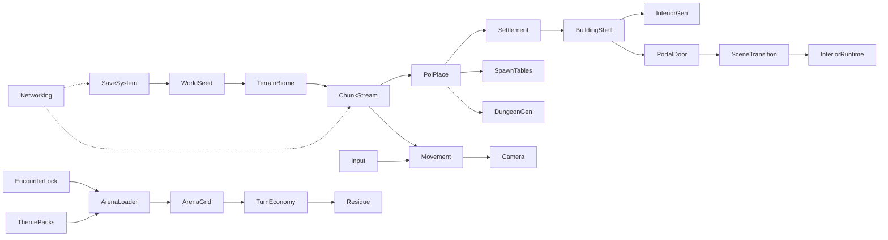

# 17 Game Systems Architecture

Version: 0.5

Status: Draft

Last Updated: 2026-08-11

Depends On:
[16 Architecture Pivot](16%20Architecture%20Pivot.md), [14 World Generation Roadmap](14%20World%20Generation%20Roadmap.md), [15 Procedural Building Generation](15%20Procedural%20Building%20Generation.md), [12 Engine Choice](12%20Engine%20Choice.md), [11 Vertical Slice](11%20Vertical%20Slice.md), [10 Turn Action Economy](10%20Turn%20Action%20Economy.md), [10.1 Grid World and Environment Actions](10.1%20Grid%20World%20and%20Environment%20Actions.md), [08 Confront Constraints](08%20Confront%20Constraints.md), [02 World Laws](02%20World%20Laws.md), [03 Decision Engine](03%20Decision%20Engine.md)

Referenced By:
[AGENTS.md](AGENTS.md), [14 World Generation Roadmap](14%20World%20Generation%20Roadmap.md), [90 Glossary](90%20Glossary.md), [99 Open Questions](99%20Open%20Questions.md), `unity/Assets/Plans/OVERWORLD_V0_PLAN.md`, `unity/Assets/Plans/AGENT_HANDOFF_WORLD_GEN.md`, `unity/Assets/Plans/SETTLEMENT_PROPERTY_V0.md`

---

# Purpose

This document is the **systems map authority**: which systems exist, what each owns, how they communicate, and which micro-iterations implement them.

It does **not** replace spatial / presentation locks in [16 Architecture Pivot](16%20Architecture%20Pivot.md). If a systems proposal contradicts scene rules in `16`, `16` wins.

Success question for agents:

> Can a new agent open this file, find the System Card for the feature they want, see its interfaces and upstream dependencies, and pick the next micro-iteration without inventing a monolith manager?

---

# Authority Split

| Document | Authority |
|----------|-----------|
| [16 Architecture Pivot](16%20Architecture%20Pivot.md) | Scene graph, movement mode per scene, Confront → arena |
| [14 World Generation Roadmap](14%20World%20Generation%20Roadmap.md) | Ordered world-gen phases / stop point |
| [15 Procedural Building Generation](15%20Procedural%20Building%20Generation.md) | Exterior Shell Grammar + Interior Piece Assembly; Building DNA |
| **This document (`17`)** | System registry, interfaces, save/MP/perf notes, iteration backlog |

---

# Architectural Laws

1. **No monolithic managers.** Prefer many independent systems composed by thin coordinators.
2. **Composition over inheritance.** No assigning external functions onto classes; no reflection tricks for gameplay wiring.
3. **SOLID + data-driven.** Immutable game data may live in ScriptableObjects. **Runtime state never lives in ScriptableObjects.**
4. **Determinism.** World structure generates from `WorldSeed` + coordinates (or stable ids). Do not roll gameplay-structure RNG at runtime if it can be derived.
5. **Chunk-based streaming.** Overworld expansion is effectively infinite at the API level; V0 uses a small playable stub.
6. **Interfaces and events.** Systems own their data. No circular dependencies. Hidden singletons that smuggle cross-domain state are forbidden.
7. **Independently testable.** Every system has EditMode (or pure C#) tests for its deterministic core.
8. **Iteration budget.** Never implement a feature larger than ~500 lines of code in one iteration. Design → break into subsystems → one component → review → refactor → continue.
9. **Multiplayer-ready core state.** Even while shipping single-player first, core world identity (seed, chunk payloads, POI ids, residue) must not assume local-only mutable globals.
10. **Design gates.** Combat trees, quest lines, faction lore, and economy simulation must instantiate [02 World Laws](02%20World%20Laws.md) and [03 Decision Engine](03%20Decision%20Engine.md) — this document records **boundaries and interfaces**, not full content mechanics, for gated tracks.
11. **Piece-Based Assembly, small → large.** World, Settlement, and Building/Interior generation compose from small hand-authored Pieces with Snap Sockets (Valheim-style room/dungeon piece model), never from a whole hand-tuned continuous mesh or an algorithmic subdivision solver. Binding for Track W and [15](15%20Procedural%20Building%20Generation.md); the retired OrganicTown continuous pipeline ([13](13%20City%20Generation.md)) is not a reuse source.

## Scene reminder (from 16)

```text
Overworld (seeded, free 3P)
  ├── door/portal → Interior Scene (free 3P, no grid) → exit back
  └── Confront → Combat Arena (grid TB) → return + residue
Interior ── Confront ──┘
```

## Locked V0 engineering defaults

| Default | Value |
|---------|-------|
| Chunk size | **64 m** |
| Overworld V0 playable stub | **~512 m** edge (chunk API as if infinite) |
| Interior / Arena load | **Single-scene swap** (additive later) |
| OrganicTown / TownGridBaker continuous path | **Deprecated** — archive only, not a reuse source ([13](13%20City%20Generation.md)) |
| Combat depth in near-term | Arena V0 TB skeleton + Theme Pack greybox; BG3-depth is long-horizon |

---

# System Card Template

Every system below uses this card. Fields are mandatory.

| Field | Meaning |
|-------|---------|
| **Responsibilities** | What this system owns and does |
| **Dependencies** | Upstream systems only (no cycles) |
| **Public interfaces** | Types / events other systems may use |
| **Data flow** | Inputs → transforms → outputs |
| **Save/load** | What persists; what is regenerated |
| **Multiplayer** | Authority / replication notes (even if SP-first) |
| **Performance** | Hot paths, budgets, streaming concerns |
| **Extensibility** | How V2/V3 grow without rewrite |
| **V1 scope / Deferred** | Near-term include vs later |
| **Owning folder** | Intended `unity/Assets/Scripts/…` home |

---

# Third-Party Asset Library

Which imported (and pending) third-party packages serve which System Card is tracked in `unity/Assets/Plans/ASSET_LIBRARY_REFERENCE.md` — check it before reaching for a new tool or writing custom code for terrain, vegetation, locomotion animation, or UI/camera tweening.

# World Generation Pipeline (target shape for Track W)

`unity/Assets/Plans/WORLD_GENERATION_PIPELINE.md` distills the full target world-gen pipeline (world layout → macro terrain → hydrology → biomes → materials → vegetation → roads → settlements → streaming) and cross-references each stage to a System Card below. It is not a build-order override — `OVERWORLD_V0_PLAN.md` and the Micro-iteration Backlog still govern what ships next — but every future Track W wave should stay consistent with it instead of inventing terrain features ad hoc.

---

# Track Map

| Track | Systems | Near-term code |
|-------|---------|----------------|
| **W — World Gen** | WorldSeed, Terrain/Biome, Chunk Streaming, POI Placement, Settlement, Building/Shell, Interior Gen, Dungeon Gen, Spawn Tables | **Yes — Overworld V0 first** |
| **L — Locomotion** | Input, Movement, Camera, Animation (locomotion) | After Overworld V0 |
| **I — Interior Rails** | Portal/Door, Scene Transition, Interior Runtime | After Locomotion V0 |
| **C — Confront** | Encounter Lock, Arena Loader, Theme Packs, Arena Grid, Turn Action Economy, Residue | After Interior V0 |
| **A — Actors** | NPC Gen, AI (non-combat), Dialogue | Design cards; code later |
| **Q — Quest / Info** | Quest Gen, Information Sources, POI Director | Design cards; Decision Engine gate |
| **E — Economy / Factions** | Economy, Factions, Crafting | Design cards; World Laws gate |
| **P — Player** | Inventory, Equipment, Skills/Pathways, Character Life | Design cards; Progression gate |
| **X — Cross-cutting** | Time, Weather, Save, Networking, Audio, UI | Thin cards; Save/Net contracts early |

---

# Dependency DAG



---

# Track W — World Gen (full cards)

## W.1 WorldSeed

| Field | Content |
|-------|---------|
| **Responsibilities** | Hold world identity integer/long; fork named deterministic streams (`Fork("terrain")`, `Fork("poi")`, …); never mutate seed after world create. |
| **Dependencies** | None (root). |
| **Public interfaces** | `IWorldSeed { int Value; System.Random Fork(string streamId); }` — pure, no Unity scene ownership. |
| **Data flow** | Create-world / load → seed value → consumers fork streams by stable string ids. |
| **Save/load** | Persist seed value + schema version. Regenerable derived data is not saved unless mutated by play. |
| **Multiplayer** | Host/authority owns seed; clients receive seed once and regenerate deterministic structure locally or receive chunk payloads. |
| **Performance** | Negligible; fork cost must stay allocation-light. |
| **Extensibility** | New systems add new stream ids; never reuse stream ids with different semantics. |
| **V1 scope / Deferred** | V0: int seed + string forks. Deferred: hierarchical region seeds if needed. |
| **Owning folder** | `unity/Assets/Scripts/World/Seed/` (evolve existing `WorldSeed` toward interface). |

## W.2 Terrain / Biome

| Field | Content |
|-------|---------|
| **Responsibilities** | Sample height and biome band from seed + world XZ; expose read-only sampler; no mesh ownership. |
| **Dependencies** | WorldSeed. |
| **Public interfaces** | `IBiomeSampler { float SampleHeight(Vector2 worldXZ); BiomeId SampleBiome(Vector2 worldXZ); }` |
| **Data flow** | Seed fork `"terrain"` → noise / band rules → height + biome at query point. |
| **Save/load** | Regenerated from seed; save only if player-altered terrain is ever allowed (not V0). |
| **Multiplayer** | Same seed → same samples on all peers; no per-frame sync of heightfields. |
| **Performance** | Sampling must be O(1) / cheap noise; cache per-chunk if builders need grids. |
| **Extensibility** | Swap noise implementation behind `IBiomeSampler`; add moisture/temperature channels later. |
| **V1 scope / Deferred** | V0: 2–4 biome bands + gentle height. Deferred: rivers, cliffs, full Valheim-scale biomes. |
| **Owning folder** | `unity/Assets/Scripts/World/Terrain/` |

## W.3 Chunk Streaming

| Field | Content |
|-------|---------|
| **Responsibilities** | Map world ↔ `ChunkCoord` (64 m); decide which chunks are resident around a focus; request build/teardown via interfaces; no biome math ownership. |
| **Dependencies** | Terrain/Biome (for builders it schedules), WorldSeed. |
| **Public interfaces** | `ChunkCoord`; `IChunkStreamer { void SetFocus(Vector3); IReadOnlyCollection<ChunkCoord> Resident; event ChunkLoaded; event ChunkUnloaded; }`; `ITerrainChunkBuilder { void Build(ChunkCoord); void Teardown(ChunkCoord); }` |
| **Data flow** | Focus position → desired set → build missing / teardown distant → resident set events. |
| **Save/load** | Chunk geometry regenerates; persist only chunk overrides / residues later. |
| **Multiplayer** | Interest management per player focus; authority may validate chunk residency; payload = seed-derived or delta overrides. |
| **Performance** | Hard budget: build/teardown amortized; never hitch on many chunks same frame — queue work. |
| **Extensibility** | Pluggable builders (terrain, props, POI visuals) register as composers; streamer stays thin. |
| **V1 scope / Deferred** | V0: ~512 m stub, ring streaming around editor/player focus. Deferred: async jobs, LOD, infinite travel polish. |
| **Owning folder** | `unity/Assets/Scripts/World/Streaming/` |

## W.4 POI Placement

| Field | Content |
|-------|---------|
| **Responsibilities** | Deterministically place POI markers (ruin, camp, shrine, town approach, cave mouth, …) from seed + chunk/world coords; emit stable `PoiId`. |
| **Dependencies** | WorldSeed, Terrain/Biome, Chunk Streaming (placement evaluated per chunk or world pass). |
| **Public interfaces** | `IPoiPlacer { IReadOnlyList<PoiMarker> PlaceForChunk(ChunkCoord); }`; `PoiMarker { PoiId Id; PoiKind Kind; Vector3 Position; BiomeId Biome; }` |
| **Data flow** | Chunk coord + seed fork `"poi"` + biome/height constraints → marker list. |
| **Save/load** | Marker positions regenerable; persist discovery state / Active Window / resolution elsewhere (POI Director). |
| **Multiplayer** | Same markers from seed; discovery/state is per-player or shared by design later. |
| **Performance** | Cap markers per chunk; no global scans each frame. |
| **Extensibility** | New `PoiKind` values + rules tables (ScriptableObject immutable defs). |
| **V1 scope / Deferred** | V0: 3–5 markers in stub world. Deferred: timed Side Event POIs density, multi-district. |
| **Owning folder** | `unity/Assets/Scripts/World/Poi/` |

## W.5 Settlement

| Field | Content |
|-------|---------|
| **Responsibilities** | Turn settlement-scale POIs (town approach, hamlet) into layout intents: road hints, plot footprints, district tags — **not** continuous enterable city GridMap. |
| **Dependencies** | POI Placement, WorldSeed, Terrain/Biome. |
| **Public interfaces** | `ISettlementLayout` / `ISettlementPropertyLayout` (`Plots` = building pads; `Properties` = parcels + zones + boundaries); generator from `PoiMarker` of settlement kinds (overworld hook later). |
| **Data flow** | Seed fork `"settlement_*"` → `SettlementBlockLayout` (PlotParcel + zones + boundaries + BuildingPad) → Building/Shell + feature placeholders. Overworld: Settlement POI → layout pose (deferred). |
| **Save/load** | Regenerable layout; persist only player/faction mutations later. |
| **Multiplayer** | Deterministic layout from seed; mutations replicated as deltas. |
| **Performance** | Generate on chunk/settlement demand; cache layout data. |
| **Extensibility** | Compose settlement layout from the Piece Kit (plot/road/block Pieces) per [15](15%20Procedural%20Building%20Generation.md) — not from the retired OrganicTown polygon generator. |
| **V1 scope / Deferred** | **Property lab S1–S8** (`SETTLEMENT_PROPERTY_V0.md`): parcels → Shell; S5 Street Spine; S6 TownApproach pose + terrain snap + dry search; S7 District Mix (`CreateDistrictMix`: Commercial + GardenSquare + Worker); S8 Street Props on ribbons. Stub layout remains for contract tests. Deferred: terraces / carved pads, TownDress meshes, full pathfinding StreetNetwork. |
| **Owning folder** | `unity/Assets/Scripts/World/Settlement/` |

## W.6 Building / Shell

| Field | Content |
|-------|---------|
| **Responsibilities** | Exterior shells / landmarks on overworld via **Exterior Shell Grammar**; door sockets; Building DNA stub fields; no in-overworld enterable interiors. |
| **Dependencies** | Settlement (or lone POI), WorldSeed; Exterior Piece Kit + DNA rules from [15](15%20Procedural%20Building%20Generation.md). |
| **Public interfaces** | `IBuildingShellBinder { ShellInstance Bind(BuildingDna dna, PlotFootprint plot, StreetContext street); }`; shell may expose `PortalSocket` when `InteriorPolicy.Portal`. |
| **Data flow** | DNA / archetype + plot + StreetContext → ShellInstance (pieces) + optional portal metadata → Interior Gen key. |
| **Save/load** | Shell regenerable; persist damage/ownership later. |
| **Multiplayer** | Deterministic instance ids from seed+plot; state deltas for damage. |
| **Performance** | Shared materials, Piece LOD slots, trim capped by wealth; HLOD later. |
| **Extensibility** | Modular TownDress library; grammar grows by Piece Kit, not whole-building prefabs. |
| **V1 scope / Deferred** | **Shell Sandbox lab** (`GameDev/Buildings/Shell Sandbox`, `BUILDING_SHELL_SANDBOX_V0.md`) runs **parallel to Overworld V0** and does not block W0.x. Production Settlement wiring after Overworld V0; Portal interiors after Interior V0 rails. Overworld V0 itself: POI markers only. |
| **Owning folder** | `unity/Assets/Scripts/World/Buildings/Shell/` |

## W.7 Interior Generation

| Field | Content |
|-------|---------|
| **Responsibilities** | Build or select Interior Scene content from building id + seed (one hand template → later Piece-Based Assembly / Room Graph). Free 3P space; **no grid**. |
| **Dependencies** | Building/Shell (portal key), WorldSeed; Piece Kit + Room Graph generator from [15](15%20Procedural%20Building%20Generation.md). |
| **Public interfaces** | `IInteriorSceneKey { BuildingId Id; int SeedFork; }`; `IInteriorCompiler { InteriorSceneSpec Compile(IInteriorSceneKey); }` |
| **Data flow** | Portal activate → scene key → compile/load interior → exit returns overworld pose. |
| **Save/load** | Geometry regenerable; persist interior mutables (looted containers, NPCs) by building id. |
| **Multiplayer** | Instance interiors per party or shared instance — decide at net layer; key stays deterministic. |
| **Performance** | One interior resident at V0; unload on exit. |
| **Extensibility** | Phase toward Room Graph compiler without changing portal contract. |
| **V1 scope / Deferred** | Interior V0: one hand template scene. DNA authority later (`99`). |
| **Owning folder** | `unity/Assets/Scripts/World/Interiors/` |

## W.8 Dungeon Generation

| Field | Content |
|-------|---------|
| **Responsibilities** | Procedural dungeon / cave interior graphs keyed from cave-mouth (or similar) POIs. |
| **Dependencies** | POI Placement, WorldSeed, Interior Generation contracts. |
| **Public interfaces** | Same interior key pattern with `PoiKind.Cave` / dungeon archetype. |
| **Data flow** | Cave POI → dungeon seed fork → room graph / template → Interior Scene. |
| **Save/load** | Regenerable layout; persist clear flags / residues. |
| **Multiplayer** | Same as interiors. |
| **Performance** | Generate on enter; cap room count V1. |
| **Extensibility** | Theme packs for dungeon moods; boss arenas still use Confront → Combat Arena, not dungeon mesh as grid. |
| **V1 scope / Deferred** | Deferred past Interior V0; V0 only places cave mouth marker. |
| **Owning folder** | `unity/Assets/Scripts/World/Dungeons/` |

## W.9 Spawn Tables

| Field | Content |
|-------|---------|
| **Responsibilities** | Deterministic creature / encounter spawn **points and table ids** per biome/chunk — not AI, not combat resolution. |
| **Dependencies** | WorldSeed, Terrain/Biome, POI Placement (avoid spawning inside POI footprints). |
| **Public interfaces** | `ISpawnTable { IReadOnlyList<SpawnPoint> ForChunk(ChunkCoord); }`; `SpawnPoint { Vector3 Pos; SpawnTableId Table; }` |
| **Data flow** | Chunk + biome + seed fork `"spawn"` → points; Encounter Lock consumes later. |
| **Save/load** | Points regenerable; persist kill/cooldowns if needed later. |
| **Multiplayer** | Points deterministic; spawn activation authority on host. |
| **Performance** | Sparse points; no per-frame queries of full world. |
| **Extensibility** | Tables as immutable SO defs; denser ecologies later. |
| **V1 scope / Deferred** | V0: simple points + table ids, no harvest. Full monster ecology later. |
| **Owning folder** | `unity/Assets/Scripts/World/Spawns/` |

---

# Track L — Locomotion

## L.1 Input

| Field | Content |
|-------|---------|
| **Responsibilities** | Read player devices; emit gameplay intents (move, look, interact, cancel). No world logic. |
| **Dependencies** | None (device layer). |
| **Public interfaces** | `IGameplayInput { Vector2 Move; Vector2 Look; bool InteractPressed; … }` |
| **Data flow** | Device → intents → Movement / UI. |
| **Save/load** | None (bindings prefs optional). |
| **Multiplayer** | Local only; remote avatars ignore local input. |
| **Performance** | Per-frame cheap. |
| **Extensibility** | Rebound actions; gamepad/KB. |
| **V1 scope / Deferred** | Locomotion V0: move/look/interact. |
| **Owning folder** | `unity/Assets/Scripts/Input/` |

## L.2 Movement

| Field | Content |
|-------|---------|
| **Responsibilities** | Free third-person locomotion on overworld/interiors (Genshin-like feel target, not parity). No grid. No TB movement. |
| **Dependencies** | Input, Chunk Streaming (collision/terrain present), Physics. |
| **Public interfaces** | `ILocomotion { void Tick(float dt, IGameplayInput); Vector3 Position; }` |
| **Data flow** | Input + grounded probes → velocity → transform. |
| **Save/load** | Persist player pose per scene. |
| **Multiplayer** | Client prediction optional later; authority pose sync. |
| **Performance** | CharacterController/rigidbody budget; no alloc spikes. |
| **Extensibility** | Climb/sprint layers later without rewriting core Tick. |
| **V1 scope / Deferred** | Locomotion V0: walk/run + jump stub. Climb-everything deferred. |
| **Owning folder** | `unity/Assets/Scripts/Locomotion/` |

## L.3 Camera

| Field | Content |
|-------|---------|
| **Responsibilities** | Follow / orbit third-person camera; collision pull-in. |
| **Dependencies** | Movement (follow target). |
| **Public interfaces** | `IFollowCamera { Transform Target; void Tick(float dt, Vector2 look); }` |
| **Data flow** | Target pose + look intent → camera transform. |
| **Save/load** | None required. |
| **Multiplayer** | Local only. |
| **Performance** | Single main camera V0. |
| **Extensibility** | Aim/shoulder modes later. |
| **V1 scope / Deferred** | Locomotion V0 follow/orbit. |
| **Owning folder** | `unity/Assets/Scripts/Camera/` |

## L.4 Animation (locomotion)

| Field | Content |
|-------|---------|
| **Responsibilities** | Drive locomotion anim states from movement metrics. |
| **Dependencies** | Movement. |
| **Public interfaces** | Thin adapter over Animator; no gameplay authority. |
| **Data flow** | Speed/grounded → anim params. |
| **Save/load** | None. |
| **Multiplayer** | Replicate metrics or use remote proxies. |
| **Performance** | Standard animator cost. |
| **Extensibility** | Overlay layers for interact/combat later. |
| **V1 scope / Deferred** | Placeholder anim OK in V0. |
| **Owning folder** | `unity/Assets/Scripts/Animation/` |

---

# Track I — Interior Rails

## I.1 Portal / Door

| Field | Content |
|-------|---------|
| **Responsibilities** | Diegetic interactable sockets on shells; emit transition requests with `IInteriorSceneKey` + return pose. |
| **Dependencies** | Building/Shell, Input (interact), Movement (player in range). |
| **Public interfaces** | `IPortal { IInteriorSceneKey Target; Pose ReturnPose; event TransitionRequested; }` |
| **Data flow** | Interact → validate → Scene Transition. |
| **Save/load** | Portal ids stable; locked/unlocked state persistable. |
| **Multiplayer** | Request to authority; travel party rules later. |
| **Performance** | Trigger volumes cheap. |
| **Extensibility** | Nested interiors, dungeon mouths share contract. |
| **V1 scope / Deferred** | Interior V0: one door. |
| **Owning folder** | `unity/Assets/Scripts/World/Portals/` |

## I.2 Scene Transition

| Field | Content |
|-------|---------|
| **Responsibilities** | Execute V0 **single-scene swap** with loading gate; pass travel payload (key, return pose, theme tags). |
| **Dependencies** | Portal/Door; Unity SceneManager. |
| **Public interfaces** | `ISceneTransition { void Travel(TravelRequest); event TravelCompleted; }` |
| **Data flow** | Request → unload source → load dest → spawn player → completed. |
| **Save/load** | Persist last stable pose before travel. |
| **Multiplayer** | Server-authoritative travel; clients load same scene id. |
| **Performance** | Accept hitch in V0; async additive later. |
| **Extensibility** | Swap implementation to additive without changing `TravelRequest`. |
| **V1 scope / Deferred** | V0 single-scene swap locked in this doc. |
| **Owning folder** | `unity/Assets/Scripts/Core/Scenes/` |

## I.3 Interior Runtime

| Field | Content |
|-------|---------|
| **Responsibilities** | Activate interior content, exit portal back to overworld, keep free 3P rules (no grid, no TB). |
| **Dependencies** | Scene Transition, Interior Generation, Movement. |
| **Public interfaces** | Interior scene bootstrap implements `IInteriorRuntime`. |
| **Data flow** | On enter compile/spawn → play → exit Travel back. |
| **Save/load** | Interior mutables by building id. |
| **Multiplayer** | Instance policy via Networking. |
| **Performance** | One interior loaded. |
| **Extensibility** | Hooks for NPC/Dialogue systems. |
| **V1 scope / Deferred** | Interior V0 greybox room. |
| **Owning folder** | `unity/Assets/Scripts/World/Interiors/` |

---

# Track C — Confront

## C.1 Encounter Lock

| Field | Content |
|-------|---------|
| **Responsibilities** | Decide Confront start from diegetic triggers; capture source theme; forbid voluntary TB in exploration. |
| **Dependencies** | Spawn Tables / content triggers; Approaches rules ([06](06%20Approaches.md), [08](08%20Confront%20Constraints.md)). |
| **Public interfaces** | `IEncounterLock { void TryBegin(EncounterRequest); event ConfrontStarted; }` |
| **Data flow** | Trigger → theme tag + participants → Arena Loader. |
| **Save/load** | Persist in-progress encounter id if mid-fight save allowed later. |
| **Multiplayer** | Host starts encounter; all clients travel. |
| **Performance** | Event-driven. |
| **Extensibility** | Ambush / scripted / Approach-chosen Confront share request type. |
| **V1 scope / Deferred** | Arena V0: one stub trigger. |
| **Owning folder** | `unity/Assets/Scripts/Confront/` |

## C.2 Arena Loader

| Field | Content |
|-------|---------|
| **Responsibilities** | Load Combat Arena via Scene Transition; select Theme Pack; hand off to Arena Grid. |
| **Dependencies** | Encounter Lock, Theme Packs, Scene Transition. |
| **Public interfaces** | `IArenaLoader { void Load(ConfrontContext); }` |
| **Data flow** | Context → theme pick → Travel → arena bootstrap. |
| **Save/load** | Context must be reconstructible. |
| **Multiplayer** | Same arena scene id for party. |
| **Performance** | V0 scene swap hitch OK. |
| **Extensibility** | Procedural arena gen later behind same loader. |
| **V1 scope / Deferred** | Arena V0 one greybox arena. |
| **Owning folder** | `unity/Assets/Scripts/Confront/` |

## C.3 Theme Packs

| Field | Content |
|-------|---------|
| **Responsibilities** | Immutable kits: Street, Tavern, Cellar, Woods, Ruin, Factory floor — mood + cover props, not 1:1 clones. |
| **Dependencies** | None (data). Consumed by Arena Loader. |
| **Public interfaces** | `ThemePackId` + SO definitions (immutable). |
| **Data flow** | Source theme tag → pack id → arena content. |
| **Save/load** | Data assets only. |
| **Multiplayer** | Identical pack ids. |
| **Performance** | Small greybox. |
| **Extensibility** | Add packs without code changes to loader. |
| **V1 scope / Deferred** | Theme Packs V0 after Arena V0 skeleton. |
| **Owning folder** | `unity/Assets/Scripts/Confront/ThemePacks/` + `Assets/Data/ThemePacks/` |

## C.4 Arena Grid

| Field | Content |
|-------|---------|
| **Responsibilities** | Square-grid spatial truth **only on arenas**; occupancy; Environment Action tags ([10.1](10.1%20Grid%20World%20and%20Environment%20Actions.md)). |
| **Dependencies** | Arena Loader / Theme Pack geometry. |
| **Public interfaces** | `IArenaGrid { bool InBounds; bool IsWalkable; … }` |
| **Data flow** | Arena bake/load → grid → Turn Economy queries. |
| **Save/load** | Static grid regenerable; dynamic cover state if any. |
| **Multiplayer** | Authoritative grid on host. |
| **Performance** | Small grids V0. |
| **Extensibility** | Multi-level arenas later. |
| **V1 scope / Deferred** | Arena V0 fixed greybox grid. |
| **Owning folder** | `unity/Assets/Scripts/Confront/Grid/` |

## C.5 Turn Action Economy

| Field | Content |
|-------|---------|
| **Responsibilities** | Move + Action + short Bonus on arenas only ([10](10%20Turn%20Action%20Economy.md)). Not a full BG3 ruleset in V0. |
| **Dependencies** | Arena Grid, Encounter participants. |
| **Public interfaces** | `ITurnEconomy { void BeginEncounter; void SubmitIntent; event TurnAdvanced; }` |
| **Data flow** | Initiative → intents → resolve → next → end → Residue. |
| **Save/load** | Mid-encounter state if supported later. |
| **Multiplayer** | Host resolves; clients show presentation. |
| **Performance** | Turn-based; low frame cost. |
| **Extensibility** | Deep systemic combat grows behind intents; Approaches remain first-class. |
| **V1 scope / Deferred** | Arena V0 skeleton. BG3-depth long-horizon. |
| **Owning folder** | `unity/Assets/Scripts/Confront/Turns/` |

## C.6 Residue

| Field | Content |
|-------|---------|
| **Responsibilities** | Apply Confront outcomes to source world (corpses, reputation stubs, locked doors) per [08](08%20Confront%20Constraints.md); no XP-from-kills. |
| **Dependencies** | Turn Economy end; Save System for persistence. |
| **Public interfaces** | `IResidueApplier { void Apply(ConfrontResult); }` |
| **Data flow** | Result → world mutables at source scene ids. |
| **Save/load** | Residue is persistent world state. |
| **Multiplayer** | Authority applies; replicate deltas. |
| **Performance** | Sparse writes. |
| **Extensibility** | Richer world memory later. |
| **V1 scope / Deferred** | Arena V0 stub flag / marker. |
| **Owning folder** | `unity/Assets/Scripts/Confront/Residue/` |

---

# Track A — Actors (thin cards; design gate)

Mechanics must not outrun Decision Engine / Vertical Slice needs. Cards define ownership only.

## A.1 NPC Generation

| Field | Content |
|-------|---------|
| **Responsibilities** | Deterministic NPC identities from seed + location slots (faction lean, role, schedule stub). |
| **Dependencies** | WorldSeed, POI/Settlement/Interior keys. |
| **Public interfaces** | `INpcGenerator { NpcSpec Create(NpcSlot); }` |
| **Data flow** | Slot + seed → spec → spawn when chunk/interior resident. |
| **Save/load** | Persist notable NPC state; trash mobs regenerable. |
| **Multiplayer** | Authority spawns. |
| **Performance** | Budget NPCs per chunk; LOD/cull. |
| **Extensibility** | Thousands of NPCs via data + streaming, not unique mono behaviours. |
| **V1 scope / Deferred** | Deferred; Vertical Slice may hand-place. |
| **Owning folder** | `unity/Assets/Scripts/Actors/Npc/` |

## A.2 AI (non-combat)

| Field | Content |
|-------|---------|
| **Responsibilities** | Exploration behaviours (idle, schedule, react to player Attention cues). Not arena TB AI. |
| **Dependencies** | NPC Gen, Movement (nav), Time. |
| **Public interfaces** | Behaviour modules composed per NPC. |
| **Data flow** | Blackboard → actions. |
| **Save/load** | Minimal AI state. |
| **Multiplayer** | Host AI. |
| **Performance** | LOD AI ticks. |
| **Extensibility** | Utility/GOAP later if needed — keep modules. |
| **V1 scope / Deferred** | Deferred. |
| **Owning folder** | `unity/Assets/Scripts/Actors/AI/` |

## A.3 Dialogue

| Field | Content |
|-------|---------|
| **Responsibilities** | Conversation presentation; Soft Memory hooks; no omniscient quest log. |
| **Dependencies** | Information Sources / Quest (content), Input, UI. |
| **Public interfaces** | `IDialogueRunner`. |
| **Data flow** | Node graph / lines → UI → outcomes events. |
| **Save/load** | Seen flags / Soft Memory. |
| **Multiplayer** | Local UI; shared world outcomes via events. |
| **Performance** | UI bound. |
| **Extensibility** | Axis-tagged lines later. |
| **V1 scope / Deferred** | Slice stubs; full system after POI cards. |
| **Owning folder** | `unity/Assets/Scripts/Dialogue/` |

---

# Track Q — Quest / Info (Decision Engine gate)

## Q.1 Quest Generation

| Field | Content |
|-------|---------|
| **Responsibilities** | Structured Decision Node sequences as data — not reward corridors. |
| **Dependencies** | [03](03%20Decision%20Engine.md), POI Director, Factions. |
| **Public interfaces** | `IQuestGraph` definitions; runtime progress store. |
| **Data flow** | Seed/faction pressure → available nodes → player choices → residue/Influence. |
| **Save/load** | Progress + outcomes. |
| **Multiplayer** | Shared or per-character — design later; persist explicitly. |
| **Performance** | Data-driven; lazy. |
| **Extensibility** | Procedural quests after hand graphs prove axes. |
| **V1 scope / Deferred** | Design cards / slice hand content first. **Gate:** Decision Engine Draft stability. |
| **Owning folder** | `unity/Assets/Scripts/Quest/` |

## Q.2 Information Sources

| Field | Content |
|-------|---------|
| **Responsibilities** | Biased partial tips ([09](09%20Information%20Sources.md)); never omniscient spoiler log. |
| **Dependencies** | POI Director, Factions, Time. |
| **Public interfaces** | `IInfoSource { Tip Sample(...); }` |
| **Data flow** | World state → tip → player Knowledge. |
| **Save/load** | Heard tips optional; Knowledge is meta. |
| **Multiplayer** | Per-player knowledge. |
| **Performance** | On interact. |
| **Extensibility** | New source kinds as data. |
| **V1 scope / Deferred** | Slice boards/rumours; system after rails. |
| **Owning folder** | `unity/Assets/Scripts/Info/` |

## Q.3 POI Director

| Field | Content |
|-------|---------|
| **Responsibilities** | Timed lazy POIs, Active Windows, unattended resolution ([04](04%20Points%20of%20Interest.md)). Distinct from geometric `IPoiPlacer`. |
| **Dependencies** | POI Placement (world anchors), Time, World Laws pressure. |
| **Public interfaces** | `IPoiDirector` — activation lifecycle events. |
| **Data flow** | Clock + Influence → activate/expire POIs → content systems. |
| **Save/load** | Active set + timers. |
| **Multiplayer** | Shared world timers on authority. |
| **Performance** | Tick sparse set. |
| **Extensibility** | Side Events as data. |
| **V1 scope / Deferred** | Existing S1 stubs may evolve; full director after Overworld rails. |
| **Owning folder** | `unity/Assets/Scripts/World/Poi/` |

---

# Track E — Economy / Factions (World Laws gate)

## E.1 Factions

| Field | Content |
|-------|---------|
| **Responsibilities** | Faction identity, Influence, Main Goals / Operations surface ([02](02%20World%20Laws.md)). |
| **Dependencies** | WorldSeed, World Laws data. |
| **Public interfaces** | `IFactionState` read model; commands for Influence shifts from residue/quests. |
| **Data flow** | Seed → starting Influence → operations → Symptoms. |
| **Save/load** | Full faction state. |
| **Multiplayer** | Shared world state. |
| **Performance** | Coarse ticks. |
| **Extensibility** | Procedural factions later. |
| **V1 scope / Deferred** | **Gate:** World Laws. Slice uses two factions hand-authored. |
| **Owning folder** | `unity/Assets/Scripts/Factions/` |

## E.2 Economy

| Field | Content |
|-------|---------|
| **Responsibilities** | Availability/prices as Influence Symptoms — not a sim-for-its-own-sake. |
| **Dependencies** | Factions. |
| **Public interfaces** | `IEconomyQuery`. |
| **Data flow** | Influence niches → listings. |
| **Save/load** | Stock deltas if any. |
| **Multiplayer** | Shared. |
| **Performance** | Query on open shop. |
| **Extensibility** | Deeper markets V2+. |
| **V1 scope / Deferred** | **Gate:** World Laws. |
| **Owning folder** | `unity/Assets/Scripts/Economy/` |

## E.3 Crafting

| Field | Content |
|-------|---------|
| **Responsibilities** | Diegetic recipes; priced power; no harvest-core from overworld V0. |
| **Dependencies** | Inventory, Economy (optional). |
| **Public interfaces** | `ICraftingService`. |
| **Data flow** | Ingredients → result + costs. |
| **Save/load** | Unlocks. |
| **Multiplayer** | Host craft. |
| **Performance** | UI bound. |
| **Extensibility** | Stations as POIs. |
| **V1 scope / Deferred** | Deferred. |
| **Owning folder** | `unity/Assets/Scripts/Crafting/` |

---

# Track P — Player (Progression gate)

## P.1 Inventory / P.2 Equipment

| Field | Content |
|-------|---------|
| **Responsibilities** | Item containers; equipment slots; diegetic loot only in Confront ([08](08%20Confront%20Constraints.md)). |
| **Dependencies** | Save; content item defs (immutable SO). |
| **Public interfaces** | `IInventory`, `IEquipment`. |
| **Data flow** | Pickup/equip → state → UI. |
| **Save/load** | Full. |
| **Multiplayer** | Per-character. |
| **Performance** | Small collections. |
| **Extensibility** | Containers/world stashes. |
| **V1 scope / Deferred** | Minimal when slice needs it. |
| **Owning folder** | `unity/Assets/Scripts/Player/Items/` |

## P.3 Skills / Pathways

| Field | Content |
|-------|---------|
| **Responsibilities** | Pathway stages 9→7; no XP level-ups ([05](05%20Progression.md)). |
| **Dependencies** | Progression design docs; Factions soft nudge. |
| **Public interfaces** | `IPathwayProgress`. |
| **Data flow** | Conduct → stage; Bargains may grant. |
| **Save/load** | Full. |
| **Multiplayer** | Per-character. |
| **Performance** | Negligible. |
| **Extensibility** | More pathways later. |
| **V1 scope / Deferred** | **Gate:** Progression Draft. |
| **Owning folder** | `unity/Assets/Scripts/Player/Progression/` |

## P.4 Character Life

| Field | Content |
|-------|---------|
| **Responsibilities** | Life boundaries, Death Gap, Legacy Cache, Soft Memory hooks ([07](07%20Character%20Life.md)). |
| **Dependencies** | Save, Factions, Meta. |
| **Public interfaces** | `ICharacterLifeCycle`. |
| **Data flow** | Death → gap → world resolve → new character. |
| **Save/load** | Meta + world. |
| **Multiplayer** | Per-player lives; shared world. |
| **Performance** | Rare. |
| **Extensibility** | Richer Soft Memory. |
| **V1 scope / Deferred** | Out of Vertical Slice; design only now. |
| **Owning folder** | `unity/Assets/Scripts/Player/Life/` |

---

# Track X — Cross-cutting

## X.1 Time

| Field | Content |
|-------|---------|
| **Responsibilities** | Game clock for POI windows, schedules; not Unity `Time` wrapper only — world time. |
| **Dependencies** | None. |
| **Public interfaces** | `IWorldClock`. |
| **Data flow** | Tick → day/phase events. |
| **Save/load** | Persist clock. |
| **Multiplayer** | Authority clock. |
| **Performance** | Coarse. |
| **Extensibility** | Calendars. |
| **V1 scope / Deferred** | Stub when POI Director needs it. |
| **Owning folder** | `unity/Assets/Scripts/World/Time/` |

## X.2 Weather

| Field | Content |
|-------|---------|
| **Responsibilities** | Visual/gameplay weather bands per biome; readable, not sim theatre. |
| **Dependencies** | Terrain/Biome, Time. |
| **Public interfaces** | `IWeatherSampler`. |
| **Data flow** | Seed+time+biome → weather id → FX. |
| **Save/load** | Regenerable or persist if player rituals alter later. |
| **Multiplayer** | Shared. |
| **Performance** | FX budget. |
| **Extensibility** | Occult weather. |
| **V1 scope / Deferred** | Deferred. |
| **Owning folder** | `unity/Assets/Scripts/World/Weather/` |

## X.3 Save System

| Field | Content |
|-------|---------|
| **Responsibilities** | Serialize world seed, player, faction, residue, POI director, inventories; never dump regenerable chunk meshes. |
| **Dependencies** | All stateful systems via explicit save contributors. |
| **Public interfaces** | `ISaveContributor`, `ISaveService`. |
| **Data flow** | Collect → versioned blob → disk; load → seed → regenerate → apply deltas. |
| **Save/load** | Self. |
| **Multiplayer** | Host save; clients not authoritative. |
| **Performance** | Async IO later; V0 sync OK. |
| **Extensibility** | Schema versions mandatory. |
| **V1 scope / Deferred** | Contracts early; full service when rails exist. |
| **Owning folder** | `unity/Assets/Scripts/Core/Save/` |

## X.4 Networking

| Field | Content |
|-------|---------|
| **Responsibilities** | Future multiplayer transport + interest; SP runs with local authority adapter implementing same interfaces. |
| **Dependencies** | Save contracts, Chunk Streaming interest, Encounter Lock. |
| **Public interfaces** | `INetAuthority`, message types for travel/encounter/residue. |
| **Data flow** | Inputs/commands → authority → state events. |
| **Save/load** | Host. |
| **Multiplayer** | This system. |
| **Performance** | Interest-managed chunks. |
| **Extensibility** | Swap transport. |
| **V1 scope / Deferred** | Interface stubs only until SP rails ship. |
| **Owning folder** | `unity/Assets/Scripts/Core/Net/` |

## X.5 Audio / X.6 UI

| Field | Content |
|-------|---------|
| **Responsibilities** | Presentation only; listen to events; no world authority. |
| **Dependencies** | Events from gameplay systems. |
| **Public interfaces** | View binders; audio cues by event id. |
| **Data flow** | Events → presentation. |
| **Save/load** | Settings only. |
| **Multiplayer** | Local. |
| **Performance** | Standard. |
| **Extensibility** | Themeable UI. |
| **V1 scope / Deferred** | Minimal HUD with locomotion/arena. |
| **Owning folder** | `unity/Assets/Scripts/UI/`, `unity/Assets/Scripts/Audio/` |

---

# Micro-iteration Backlog

Rules: one micro-plan per iteration when coding; ≤500 LOC target; Design → implement one component → review → refactor.

## Wave D — Documentation (this version of `17`)

| ID | Deliverable | Status |
|----|-------------|--------|
| D0–D4 | This document: laws, cards, DAG, backlog | Done in v0.1 |
| D5 | `unity/Assets/Plans/OVERWORLD_V0_PLAN.md` | Required companion |
| D6 | Doc transaction (`14`, `16`, `AGENTS`, Glossary, `99`, handoff) | Required companion |

## Wave W — Overworld V0 (code; after D5/D6)

| ID | Component | Outcome |
|----|-----------|---------|
| W0.1 | `IWorldSeed` / seed service | Fork streams by name; EditMode determinism test |
| W0.2 | `ChunkCoord` + 64 m math | World↔chunk↔local; tests |
| W0.3 | `IBiomeSampler` stub | Height + biome band from seed+xz |
| W0.4 | `ITerrainChunkBuilder` greybox | Plane/height mesh per chunk |
| W0.5 | `IChunkStreamer` | Load/unload around focus; thin coordinator |
| W0.6 | `IPoiPlacer` | 3–5 markers (ruin, camp, shrine, town approach, cave) |
| W0.7 | `ISpawnTable` stub | Biome → spawn points data only |
| W0.8 | Overworld lab scene + menu | Seed → generate stub world; bake/clear |
| W0.9 | Handoff update | `14` Where We Stopped + handoff |

Detail acceptance: [OVERWORLD_V0_PLAN.md](unity/Assets/Plans/OVERWORLD_V0_PLAN.md).

## Wave L — Locomotion V0

| ID | Component | Outcome |
|----|-----------|---------|
| L0.1 | `IGameplayInput` | Move/look/interact |
| L0.2 | `ILocomotion` | Walk/run on overworld collision |
| L0.3 | `IFollowCamera` | Orbit/follow |
| L0.4 | Lab wiring | Play mode smoke on Overworld stub |

## Wave I — Interior V0

| ID | Component | Outcome |
|----|-----------|---------|
| I0.1 | `IPortal` on one landmark | Interact prompts transition |
| I0.2 | `ISceneTransition` single-scene swap | Travel payload |
| I0.3 | One interior greybox scene | Exit returns to overworld pose |
| I0.4 | Free move in interior | No grid |

## Wave C — Arena V0 + Theme Packs V0

| ID | Component | Outcome |
|----|-----------|---------|
| C0.1 | `IEncounterLock` stub trigger | Captures theme tag |
| C0.2 | `IArenaLoader` + one arena scene | Scene swap into arena |
| C0.3 | `IArenaGrid` greybox | Walkable cells |
| C0.4 | `ITurnEconomy` skeleton | End encounter → return |
| C0.5 | `IResidueApplier` stub | Marker/flag in source |
| C0.6 | Theme Packs V0 | Street / tavern / woods greybox kits |

## Later waves (named only)

- Vertical Slice content on new rails ([11](11%20Vertical%20Slice.md))
- Building DNA / Interior compiler phases ([15](15%20Procedural%20Building%20Generation.md))
- NPC / Dialogue / Quest / Economy / Pathways code after respective design gates
- Additive scene loading; richer biomes; networking transport

---

# Explicitly Out (until named wave)

- Survival harvest / base-building core loop
- Continuous enterable OrganicTown GridMap as world truth
- Voluntary Turn-Based Mode during exploration
- Monolithic `GameManager` owning multiple domains
- Runtime-random world structure (non-seeded)
- Full BG3 combat feature parity in Arena V0
- Marketplace tactics kit as architecture

---

# Agent Instructions

1. Read [16](16%20Architecture%20Pivot.md) for scene locks, then this file for system ownership.
2. Next **code** default: [OVERWORLD_V0_PLAN.md](unity/Assets/Plans/OVERWORLD_V0_PLAN.md) iterations W0.1 → W0.9.
3. Before coding a system, open its System Card; if the card is Deferred/gated, do not invent a full implementation.
4. If architecture must change, update this document (and contradict-check `16`) **before** code.
5. OrganicTown is deprecated and not a reuse source ([13](13%20City%20Generation.md)). Only generic, non-city-specific patterns already specified independently in this document carry forward: deterministic `WorldSeed` fork-by-name (W.1) and the modular art dressing library (`PROCEDURAL_TOWN_ASSET_LIBRARY.md`). Do not port OrganicTown's polygon/continuous-mesh generation code or algorithms.

---

# Documentation Review

- **Vision / Pillars:** Preserved — Curiosity, priced power, living finite world.
- **16 Pivot:** Not reversed — free 3P overworld/interiors; grid arena-only; OrganicTown archive.
- **02 / 03 gates:** Quest/Faction/Economy/Pathway cards are boundaries only until Draft foundations instantiate.
- **Solo / AI shipability:** Micro-iterations W/L/I/C isolate products.

---

# Related Documents

- [16 Architecture Pivot](16%20Architecture%20Pivot.md)
- [14 World Generation Roadmap](14%20World%20Generation%20Roadmap.md)
- [15 Procedural Building Generation](15%20Procedural%20Building%20Generation.md)
- [12 Engine Choice](12%20Engine%20Choice.md)
- [11 Vertical Slice](11%20Vertical%20Slice.md)
- [08 Confront Constraints](08%20Confront%20Constraints.md)
- [90 Glossary](90%20Glossary.md)
- [99 Open Questions](99%20Open%20Questions.md)
- [AGENTS.md](AGENTS.md)
- `unity/Assets/Plans/OVERWORLD_V0_PLAN.md`
- `unity/Assets/Plans/AGENT_HANDOFF_WORLD_GEN.md`
- `unity/Assets/Plans/ASSET_LIBRARY_REFERENCE.md`
- `unity/Assets/Plans/WORLD_GENERATION_PIPELINE.md`
